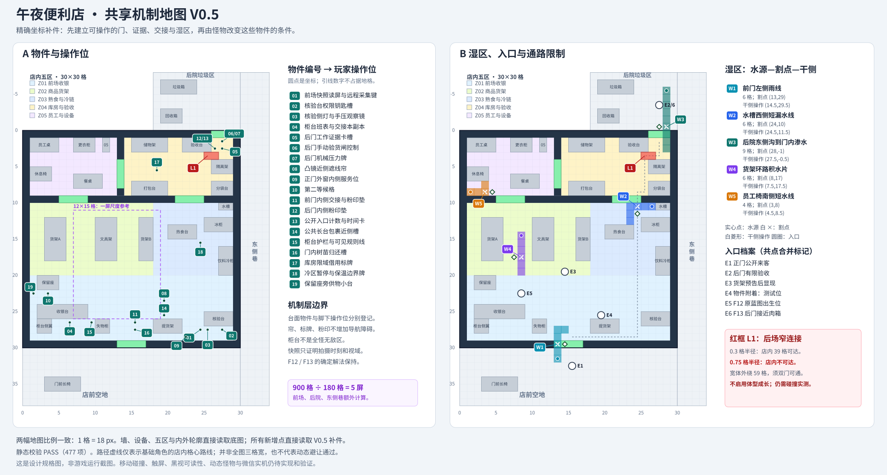

# 午夜便利店 Ruler Control

## SA01：全系统自洽审计与便利店设备（2026-11-19）

本轮对照当前营业、TD05、MD01、EQ01与MA01，修正已找到的范围、旧道具适用域、停用设备消费者、操作阶段与整周事务冲突。**目前不能宣称完整游戏所有机制都已自洽并实机验证：已有明确合同、尚未启用的候选和仍缺的设计分别列出。** 14类真实设备已有营业/规则/空间职责，本轮补齐双用途候选；没有免费给每台设备复制一座塔的能力。

| 入口 | 内容 |
|---|---|
| [本轮总审计](docs/80_sa01_system_audit.md) | 真实问题、修订依据、结论及运行边界 |
| [设备营业与塔防职责](docs/81_sa01_facilities.md) | 14类设备、3台真实电器、5个数值候选与其成本；候选全部未启用 |
| [整局/整周与剩余设计](docs/82_sa01_missing_design.md) | 失败整笔回滚、跨周工资、统一钱包、地图/排程/教学等优先级 |
| [旧部署迁移桥](docs/83_sa01_legacy_bridge.md) | B01–B08、I16、Q08的班前锁、共同容量、余量和原物归属 |
| [跨系统权威](content/system_authority_sa01.json) | 各版本的唯一消费者与操作阶段；旧练习和拟实现模式分开 |
| [当前审计报告](docs/sa01_validation_report.json) | 来源、范围、报告新鲜度与有限验证；不等同整周试玩 |

小范围敌方圆统一至少1.5格，12挂点补偿按真实可用地面重新核验。旧营业模块已修复停用的门加固/保温仍可购买的问题。当前两怪HTML仅刷新既有物品路由元数据；它不包含该营业模块，也没有因此接入完整新战斗。详见总审计。

复现本轮：

```sh
python3 scripts/check_td05_balance.py
python3 scripts/check_ma01_reference.py
python3 scripts/render_ma01_design.py
python3 scripts/check_ma01_design.py
python3 scripts/render_ma01_design.py
python3 scripts/check_sa01_lifecycle.py
python3 scripts/check_sa01_legacy_bridge.py
node prototype/check_store_core_v05.mjs
python3 scripts/build_playable_v09.py
python3 scripts/check_sa01_design.py
```

## MA01：怪物攻击设计基础

在既有105怪、TD05塔陷阱与EQ01装备上，补齐逐怪攻击几何、蓄力/收招、冲刺与危险体表、射线、投石打断仪式后追击、丝带缠绕与免费脱困。保留原三结局、数值主体、子体和奖励预算。**设计与有限参考模型已补，完整世界AI/地图/美术尚未接入。**

- [系统总览](docs/73_ma01_attack_overview.md) · [攻击规则](docs/74_ma01_attack_rules.md) · [投石与缠绕](docs/75_ma01_ritual_tether.md)
- [60民俗攻击](docs/76_ma01_folklore_attacks.md) · [45SCP攻击与子体](docs/77_ma01_scp_attacks.md)
- [配合与平衡](docs/78_ma01_balance.md) · [验证范围](docs/79_ma01_validation.md)
- 数据：[共享攻击合同](content/attack_contracts_ma01.json) · [105攻击索引](content/monster_attack_roster_ma01.json)


## EQ01：装备能力与特殊奖励

EQ01完成六槽36张装备目录（34个启用设计候选、2个原停用条目）、18种特殊消耗品、短时奔跑与塔防配合、完整三品质抽奖池。装备/个人道具跨周保留，塔陷阱与建造币沿TD05周清。所有新增运行准入仍关闭，待实际世界适配与试玩。

- [系统总览](docs/66_eq01_system_overview.md)
- [完整装备目录](docs/67_eq01_equipment_catalog.md)
- [特殊道具目录](docs/68_eq01_consumable_catalog.md)
- [抽奖奖励与获取](docs/69_eq01_lottery_rewards.md)
- [搭配与数值](docs/70_eq01_builds_and_balance.md)
- [验证范围与结果](docs/71_eq01_validation.md)
- [官方设计参考](docs/72_eq01_sources.md)
- 数据入口：[共享规则](content/equipment_contracts_eq01.json)、[装备](content/equipment_eq01.json)、[特殊道具](content/consumables_eq01.json)、[奖池](content/lottery_rewards_eq01.json)

下方MD01/TD05仍是怪物、塔与陷阱基础；相同主题若被EQ01明确修订，以本节链接为准。

---

## 项目与运行范围

面向微信小游戏的2D俯瞰规则怪谈游戏。**当前运行基线仍为V0.10。最新玩法设计MD01把60个既有民俗条目与本轮新增45项SCP改编整理为105项怪物/异常遭遇，逐条明确机制结局、移动、速度、HP、防御与塔陷阱对策；抽奖机先完成方向。设计数据尚未接入完整客户端。**

每晚00:00—06:00，玩家边工作边判断：欢迎语是不是邀请、空座是否有人、湿路把货拖向哪里、叫自己名字的同事能否信任。普通扫码和找零简化；搬运、朝向、距离、取放、封存、声音窗口和门槛保持实际操作。

本仓库包含设计、结构化内容、精确地图、有限世界执行器、两怪独立HTML练习及静态和无画面检查。**当前没有微信发行客户端；60张设计卡不等于60个已实现AI，图形界面和手机操作仍待实测。**

## MD01 最新怪物设计：105项、三种结局与店内抽奖机

本轮按真实仓库范围补齐 **60个既有民俗＋45个新增SCP改编**。每项分配“机制解锁击退”“完成机制离场”或“完成机制削弱”，并列出实际线索/免费用品/步骤/时窗、移动模式与速度、HP/物防/灵防、技能封印、群体预算及根奖励。正常人类不作怪物目标；F14仍默认排除。新增SCP的出处与署名单独列明。

| 入口 | 内容 |
|---|---|
| [MD01总览](docs/57_md01_monster_overview.md) | 分配原则、三类结局、105范围与版本权威 |
| [105项完整属性表](docs/65_md01_all_stats.md) | HP、物/灵减免、体速前后、首现日 |
| [60民俗逐条](docs/58_md01_folklore_roster.md) | 原有身份/原物机制与新战斗结局 |
| [SCP前23项](docs/59_md01_scp_roster_a.md) / [后22项](docs/60_md01_scp_roster_b.md) | 45个新增机制、分裂/召唤、数值和应对 |
| [战斗与终态](docs/62_md01_combat_lifecycle.md) | 锁血不重置HP，压制重构，电伤真实扣血，根奖励去重 |
| [抽奖机方向](docs/61_md01_lottery_direction.md) | 每完成正式一晚交班给1券、个人装备/道具、保底及班前边界 |
| [校验结果](docs/63_md01_validation.md) / [机器报告](docs/md01_validation_report.json) | 逐卡合同、有限生命/电图、状态守恒与发券去重 |
| [数据索引](content/monster_roster_md01.json) / [共享合同](content/monster_contracts_md01.json) | 三分片105项的唯一入口与命名空间 |
| [SCP署名](docs/64_md01_scp_attribution.md) / [内容许可](SCP_CONTENT_LICENSE.md) | 逐篇原文/作者与CC BY-SA 3.0改编文本声明 |

MD01只覆盖怪物结局/参数及抽奖方向；TD05完整塔树、陷阱、异常状态、班前采购和七日布防仍有效。运行 `python3 scripts/render_md01_roster.py` 后执行 `python3 scripts/check_md01_design.py` 可复核。**没有宣称105个AI、动态导航、完整随机奖池或手机试玩已实现；本轮未进入美术。**

## TD05 塔防基础：追逐、连锁电击与班前布防

完整保留 **10塔族→20个L2→40个L3** 与16系80节点陷阱，更新60条既有怪物适配。位移塔同格同伤，真实转场增加计伤机会与保底；电击原生D=6，每个正伤受体回填1电，**没有每波反馈总量上限或代际衰减**；货架遮挡以合法有效面积补偿；新增易感；纸偶最多拖1秒并快速重组；普通怪略快于玩家；陷阱先购买、每日班前布置，营业后不可补充。

**TD05是当前设计与可执行参考模型，尚未接入V0.10游戏运行器。** 本轮以1–2只有限生命敌人为电击主调校，再看提前减员与群体；七夜保留真实装置与库存，第七夜结算后统一清空。本轮继续完成设计，未进入美术。

| 入口 | 内容 |
|---|---|
| [设计总览](docs/51_td05_revision_overview.md) | 玩家澄清、完整循环、分支改动与当前权威 |
| [战斗合同](docs/52_td05_combat_contracts.md) | 同价跨区、易感、无总额上限电链、死亡缩图、范围与纸偶 |
| [完整塔树](docs/53_td05_tower_tree.md) | 70节点、两级特化、数值、敌人适配与代价 |
| [陷阱/几何/经济](docs/54_td05_traps_geometry_economy.md) | 80节点、班前实物库存、12挂点补偿与七夜定价 |
| [追逐与60怪](docs/55_td05_chase_monsters.md) | 移速、完整位移周期、正确回应、逐怪分支适配 |
| [调校结果](docs/56_td05_balance_results.md) | 八行为、有限生命电击、提前减员、库存与周清 |
| [塔数据](content/tower_defense_td05.json) / [合同数据](content/combat_contracts_td05.json) | 当前拟实现的绝对参数与事件合同 |
| [陷阱设备](content/traps_facilities_td05.json) / [怪物适配](content/monster_matchups_td05.json) | 实际空间与原型身份对应 |
| [追逐数据](content/chase_profiles_td05.json) / [周经济](content/economy_week_td05.json) / [场景](content/balance_scenarios_td05.json) | 可复算速度、库存收支与模型输入 |

运行 `python3 scripts/check_td05_balance.py` 重算；SA01修订后的当前[机器报告](docs/td05_balance_report.json)通过 **753 项**，0失败，保留输入与实际依赖脚本哈希。它不替代客户端战斗、动态导航和手机试玩。TD04及更早TD文档是历史记录；未被TD05修改的既有营业、身份与原物规则继续保留。

## 两怪规则实操

[下载独立HTML文件](prototype/playable_v09.html) · [操作与构建指南](docs/28_playable_slice_v09.md) · [运行集成审计](docs/27_runtime_integration_v09.md)

下载HTML后在支持JavaScript与Canvas的桌面浏览器中打开；GitHub代码页本身只展示源文件。练习使用原地图的真实移动、碰撞和工位动作：F12取回形针并撒向正门外，F13把同一箱生肉运入有效冰柜并合盖。网页另提供有限日间计划、补给与四资源。练习复制当前个人状态，不写回正式资产、不发正式工资。文件无外部运行依赖；浏览器渲染、真实触控、微信兼容和手机性能尚未验收。

## V0.10运行基线与历史机制阅读

| 文档 | 内容 |
|---|---|
| [第一步收口与独立反例](docs/34_stage_one_freeze_v010.md) | 本轮接续、真实截止、末次效果、债单预算及第一步/第二步顺序 |
| [V0.10修订与权威边界](docs/00_revision_v010.md) | 本轮逻辑闭环、趣味取舍、当前13组合与真实实现边界 |
| [全局机制和20条店规复核](docs/33_logic_completion_and_fun_v010.md) | 四资源、实际血源、身份、物件、双时钟和收益消费者 |
| [F01–30逐卡审计](docs/29_mechanism_audit_v010_a.md) / [F31–60逐卡审计](docs/30_mechanism_audit_v010_b.md) | 每卡实际正常操作、错误恢复、预防/拒绝、到期和趣味性 |
| [事件与组合](docs/32_events_combinations_closure_v010.md) / [辅助系统](docs/31_auxiliary_closure_v010.md) | 72事件、18组合目录/13当前候选、64道具装备宠物部署 |
| [V0.9修订与权威边界](docs/00_revision_v09.md) | 实际走位、日夜资源、统一结算与实现边界 |
| [运行集成审计](docs/27_runtime_integration_v09.md) | 多份SAN、精确咖啡到期、世界与预算时钟、F53与店长、工资去重 |
| [两怪实操指南](docs/28_playable_slice_v09.md) | 控制、实际工作、黑视与恢复、日间计划、独立副本和保存 |
| [第三轮自洽审计](docs/26_third_consistency_audit_v08.md) | 跨阶段无效联动、活动截止、赠食核验、有限收益、知识与辅助效果 |
| [第二轮自洽审计](docs/25_second_consistency_audit_v07.md) | 不可达店长、短路线、晚接单、奖励消费者、重复提交与完整血源闭环 |
| [第一轮条件审计](docs/23_condition_consistency_v06.md) | 基础来源、证据、资源及06:00结算；结合后续两轮修订阅读 |
| [60卡条件矩阵](docs/24_condition_matrix_v06.md) | 每卡必要来源、提前处理、到期和拒绝终态 |
| [Claude审查回应](docs/19_claude_review_response_v05.md) | 对实际GitHub提案逐项采纳、重做与不采用，附固定提交来源 |
| [门店机制完整设计](docs/20_store_gameplay_v05.md) | 10种机制、六阶段、预兆、应急电、四资源、营业与失败取舍 |
| [60种当前怪物玩法](docs/21_monster_gameplay_v05.md) | 每怪核心禁忌、实际动作、恢复、免费解、两项事件变体 |
| [地图机制补件](docs/22_map_mechanics_v05.md) | 19物件、12位置组、5湿区、2防窗组、6入口档与真实几何限制 |
| [五屏底图与日间地图](docs/13_maps_v04.md) | 连续门店、前场后院、玩家家、道具店、资料室 |
| [F12/F13精确蓝图](docs/11_encounters_v03.md) | 回形针诱离与登记生肉入柜，优先于泛用模板 |
| [验证范围与结果](docs/09_validation.md) | 数据、静态地图、实际坐标模拟、集成事务及尚未完成的图形验收 |



## V0.10具体修正

- 60卡从来源到终态都具有可执行的有限动作合同；每步核对原物、当前条件、实际路线和提交结果，取消不偷耗物资，失败和自然到期也有明确结果。
- 实际流血仍只来自已定义的玻璃接触，90世界秒；每走2格留下30秒血迹。没有血源就不投相关条件怪，不让导演为抽中的怪物补写伤口。
- 修正F38长达数小时的连续盯人要求、F53错误瓶槽及06:00后补走交班、F59维修收益被免费复位完全替代的问题。
- 百鬼夜行固定队列与两张原订单使用可达窗口，期间仅世界内动作；QTE不再花光班次预算却让世界队列停在门前。
- S05双追逐和S14前雨/后门货物不相交的伪联动归档，当前保留13项有实际来源的组合；不通过增加新主怪或虚构历史制造难度。
- F57保留真实北侧安全路线，限时维护换SAN+4一次；F07/F52等有限奖励有实际领取或完成读点，旧卡资源草案不重复生效。
- 24道具、24装备、8宠物、8部署共64目录项逐项对应消费者、时长、消耗和失效；无消费者的耐久维修、通用门撑等保持关闭。

完整改变见[V0.10说明](docs/00_revision_v010.md)。有限模型通过与设计可玩性审查不等于已经完成移动AI、手机触控或一周试玩；[机器报告](docs/validation_v010_report.json)保留输入哈希和确切范围。

## 门店机制与保留决定

- 普通事务压缩，保留持物、背向移动、距离、节拍、开关与封存；每怪一个主要危险、最多三个关键步骤。
- 12格应急储备换额外观察和缓冲。基础冰柜、手动门、必要物件与免费核验不依赖它；四个人体资源精力、SAN、饱腹、体力全部保留。
- 预兆进入世界物件，初见不自动报正确怪名。真实记录也有时刻与视域；监控不能直接看穿伪装，便签署名和印章不自动授予权限。
- 全夜预排6单窗口领取、6单需实际入店。一直窗口可减少部分入店风险但最多6单；A级8单需要承担适量开门风险。少做经营降评级，不再直接判整夜失败。
- 取消全夜三次违规撤班，按怪物自身条件产生局部后果并给恢复动作；店务债最多1张、延续1阶段、本类工资扣款最多20币。
- F12不恢复吃铁成长、啃门或体型导航。F13任务肉不被吃掉，提前入柜可成功，已完成实例不因普通断电复活。
- 五屏地图尺寸和三张日间地图保留；补上真正可操作的位置。后场仍存在宽体无法穿过的窄连接，已显式记录，未假称全部通道有3格宽。

## 持续保留的共识

一周一个周期，七天使用相同阶段；通常每小时一个新主遭遇，有益怪也占名额，重大事件替换。20条逐步解锁店规、72项事件目录（当前设计候选71项）、60种民俗原型；低SAN缩QTE判定与黑视，但不随机改输入。

两个员工含主角，另有店长，同事和店长可能被假扮。白天学习、休息、购物、装备与宠物照料继续存在。24种即时道具、24件装备、8宠物及8部署目录保留（当前22项道具、22件装备为获取候选，另有构建能力门槛）；宠物继续有通用与指定怪作用，不能单独证明身份或自动解除。

初版F14附身候选仍默认关闭。其余59个默认候选也须通过实际功能、已知规则、当前路线与预算门槛；设计完整不等于可以运行时投放。

## 结构化入口

| 文件 | 当前用途 |
|---|---|
| [mechanism_closure_v010.json](content/mechanism_closure_v010.json) | 当前统一闭环定义、作用边界、时钟与消费者 |
| [mechanism_cases_v010_a.json](content/mechanism_cases_v010_a.json) / [mechanism_cases_v010_b.json](content/mechanism_cases_v010_b.json) | 60怪实际有限状态、动作、计时器、误操作和终态见证 |
| [event_contracts_v010.json](content/event_contracts_v010.json) / [composition_contracts_v010.json](content/composition_contracts_v010.json) | 72事件与18组合目录的现行来源、操作与准入 |
| [auxiliary_effects_v010.json](content/auxiliary_effects_v010.json) | 64辅助目录项的具体效果与消费者 |
| [integration_v09.json](content/integration_v09.json) | 两怪练习范围、状态归属、24小时日历、债务与正式交班顺序 |
| [consumer_closure_v08.json](content/consumer_closure_v08.json) | 赠食核验、有限友好收益、F53履约与交班、F31/P08短休、E062睡眠 |
| [temporal_resource_contract_v07.json](content/temporal_resource_contract_v07.json) | 实际时限、历史交接、角色到场、局部路线与有限奖励补充 |
| [auxiliary_targets_v07.json](content/auxiliary_targets_v07.json) | 辅助效果的消费者、增时上限与暂停获取项目 |
| [condition_lifecycle_v06.json](content/condition_lifecycle_v06.json) | 当前60卡条件、伤情、物资、时钟、身份与终态合同 |
| [condition_reachability_v06.json](content/condition_reachability_v06.json) | 独立来源依赖模型，附删除来源负例；不是完整通关证明 |
| [store_systems_v05.json](content/store_systems_v05.json) | 门店机制、普通工作、预兆、营业、电量、信息、结算与实现边界 |
| [encounters_v05.json](content/encounters_v05.json) | 当前60怪玩法与120个条件变体 |
| [map_mechanics_v05.json](content/map_mechanics_v05.json) | 精确机制附件、湿区、入口和局部路程 |
| [maps.json](content/maps.json) | 既有四场景底图与42基础锚点；和V0.5补件合用 |
| [monsters.json](content/monsters.json) / [sources.json](content/sources.json) | 原型、来源、候选策略和当前玩法索引 |
| [encounter_blueprints.json](content/encounter_blueprints.json) | F12/F13权威参数、目标切换和原子成功 |
| [balance.json](content/balance.json) / [rules.json](content/rules.json) | 四资源、固定日程、当前评级、20条店规 |
| [interactions.json](content/interactions.json) / [qte.json](content/qte.json) | 基础动作、异常工位特写、SAN/QTE |
| [events.json](content/events.json) | 72事件和当前/历史变体的分别引用 |
| [items.json](content/items.json) / [equipment.json](content/equipment.json) | 道具、抽奖、装备；I06电池用途互斥消费 |
| [pets.json](content/pets.json) / [deployables.json](content/deployables.json) | 通用/专属宠物帮助与有限部署 |

V0.4的[完整旧卡](docs/12_all_encounters_v04.md)和[机制模块](docs/14_systems_and_director_v04.md)作为历史推导与组件参考保留，不能覆盖当前V0.10合同。Claude的[审查](docs/16_review_rules_maps_v04.md)与[预兆提案](docs/17_omen_system_proposal_v04.md)保留原文；[PR #2](https://github.com/6b72p5646w-cyber/Ruler-Control/pull/2)原提案通过固定提交引用，未直接合并。

## 验证与复现

```sh
python3 scripts/build_playable_v09.py
python3 scripts/run_validation_v010.py
# 以下为各组单独复现入口
python3 scripts/validate_content.py
python3 scripts/validate_design_v05.py
python3 scripts/validate_maps.py
python3 scripts/validate_map_mechanics_v05.py
python3 scripts/validate_conditions_v06.py
python3 scripts/validate_consistency_v07.py
python3 scripts/validate_closure_v08.py
python3 scripts/validate_integration_v09.py
python3 scripts/validate_mechanisms_v010.py
python3 scripts/validate_auxiliary_v010.py
python3 scripts/validate_events_compositions_v010.py
node prototype/check_rule_core.mjs
node prototype/check_store_core_v05.mjs
node prototype/check_condition_core_v06.mjs
node prototype/check_admission_core_v07.mjs
node prototype/check_reward_core_v07.mjs
node prototype/check_day_knowledge_core_v08.mjs
node prototype/check_consumer_core_v08.mjs
node prototype/check_day_cycle_core_v09.mjs
node prototype/check_world_core_v09.mjs
node prototype/check_shift_settlement_core_v09.mjs
node prototype/check_practice_session_v09.mjs
python3 scripts/check_panic_routes_v06.py
python3 scripts/check_temporal_routes_v07.py
python3 scripts/render_encounters.py
python3 scripts/render_condition_matrix.py
python3 scripts/render_maps.py
python3 scripts/render_map_mechanics_v05.py
```

旧内容检查保留历史数据完整性，新检查覆盖当前60卡和店铺机制，另有60个独立条件来源见证及缺源负例。两怪新增真实坐标、碰撞、追逐与同物动作的确定性模拟，其余参考覆盖有限合同。静态与无画面检查不能证明任意怪物组合公平、触控舒适、浏览器渲染或微信性能；完整结果和输入SHA以[验证文档](docs/09_validation.md)为准。

## 系统资料

[固定日夜循环](docs/01_core_loop.md) · [四资源与白天](docs/02_resources_and_daytime.md) · [员工与假扮](docs/03_staff_and_impersonation.md) · [物品装备宠物](docs/04_items_equipment_pets.md) · [事件目录](docs/05_events_and_director.md) · [民俗资料](docs/06_folklore_bestiary.md) · [20条店规](docs/07_rules.md) · [制作顺序](docs/08_implementation_plan.md)
