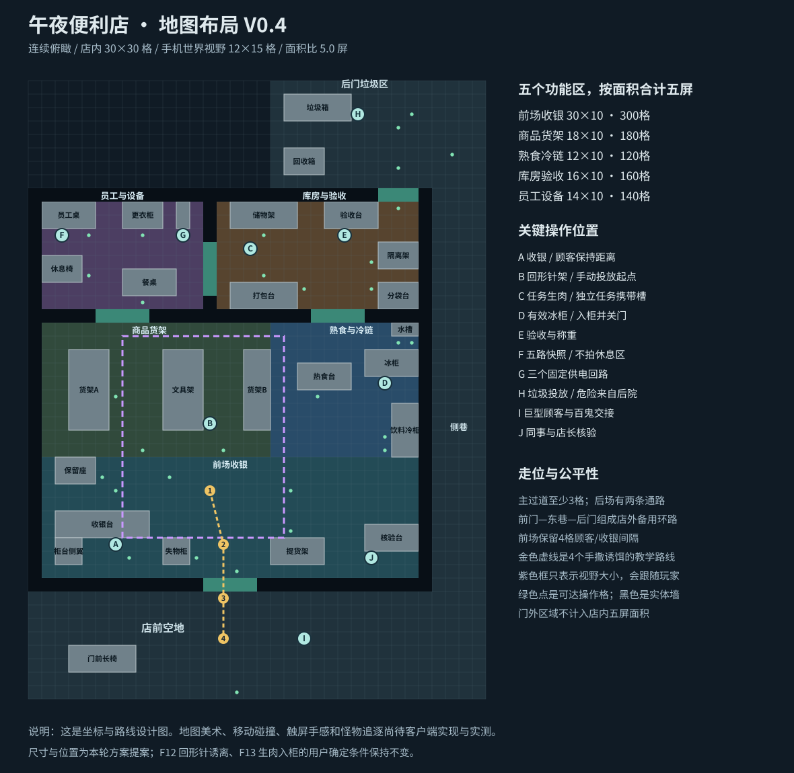

# 午夜便利店 Ruler Control

面向微信小游戏的2D俯瞰规则怪谈经营与生存设计。当前为 **V0.4：60种怪物的实际交互规则、120种遭遇变体与完整地图布局**。

玩家是便利店夜班店员，00:00—06:00一边营业、一边处理异常。怪物把扫码、搬货、冷链、清洁、盘点、交班和设备管理变成有条件的动作问题；随机事件改变对象、路线、环境或时间窗口。

本仓库包含设计、结构化内容、精确地图图纸、静态路线检查与小型无画面规则参考。**地图移动客户端、触控、美术、完整AI和微信适配尚未实现**；60种是完整设计提案，不是已经可玩的60种角色。

## 本轮交付

- F01—F60每种都有线索、操作步骤、状态转移、成功条件、失败补救、免费基础解、四资源、条件难度、地图锚点与至少两个现有事件变体。
- 店内30×30格，默认手机世界视野12×15格，面积约5屏，连续滚动。前场、后院垃圾区和东侧通道额外计算。
- 玩家家、道具店、民俗资料室各一张12×15单屏地图；街区采用行程菜单连接。共4个物理场景与1个节点行程图。
- 12类共享机制复用既有10动作、16店务、3QTE和8空间组件。参考作品的方法、传统母题与本作原创分开记录。
- F12回形针诱离、F13登记生肉入柜的用户确定条件保持不变；完成后锁定本实例，不受普通开门/断电影响而复活。

## 优先阅读

| 文档 | 内容 |
|---|---|
| [V0.4修订与决定边界](docs/00_revision_v04.md) | 用户明确要求、本轮新增提案、规格优先级 |
| [60种完整交互卡](docs/12_all_encounters_v04.md) | 全60种操作、状态、失败恢复和120个变体 |
| [完整地图](docs/13_maps_v04.md) | 五屏尺度、门内门外、日间地图、坐标和路线预算 |
| [共享机制与导演](docs/14_systems_and_director_v04.md) | 12模块、时钟、联动、排他资源和准入顺序 |
| [参考作品的具体推导](docs/15_design_references_v04.md) | FNAF、躺平发育及原创改编边界 |
| [验证范围和结果](docs/09_validation.md) | 已检查内容及尚需客户端/实机完成的验收 |
| [怪物规则与地图适配审查](docs/16_review_rules_maps_v04.md) | V0.4数据不一致、设计判断、可玩性对照与代码可及性（审查建议，未改数据） |
| [怪物预告线索与交互规则优化](docs/17_omen_system_proposal_v04.md) | 远兆/近兆/临门预告、一怪一禁令、准备代价与通用状态机（设计提案） |



[手机操作尺度](docs/maps/phone_view.svg) · [白天地图](docs/maps/daytime_layouts.svg)

## 持续保留的共识

一周一个周期，七天使用同一套日夜阶段；通常每小时一个新主遭遇，重大事件替换。四资源为精力、SAN、饱腹和体力。低SAN缩小QTE判定区、产生黑视，但不随机改写输入，HUD、取消和紧急操作保持可用。

世界动作负责走位和追逐，工位面板负责安排，安全特写负责精细动作。追逐中的拿回形针、洒放、搬肉、入柜不弹QTE。两个员工包含主角，另有店长，同事和店长都可能被假扮；身份、物件凭证和权限分别核验。宠物有通用辅助与指定怪物技能，部署装置帮助完成工作，基本解法不依赖抽奖、稀有装备或宠物。

| 系统 | 详细文档 |
|---|---|
| 固定日夜循环 | [01_core_loop.md](docs/01_core_loop.md) |
| 四资源与白天行动 | [02_resources_and_daytime.md](docs/02_resources_and_daytime.md) |
| 同事、店长与假扮 | [03_staff_and_impersonation.md](docs/03_staff_and_impersonation.md) |
| 24道具、24装备、8宠物、8部署 | [04_items_equipment_pets.md](docs/04_items_equipment_pets.md) |
| 72项随机事件 | [05_events_and_director.md](docs/05_events_and_director.md) |
| 60原型的母题与资料 | [06_folklore_bestiary.md](docs/06_folklore_bestiary.md) |
| 20条逐步解锁店规 | [07_rules.md](docs/07_rules.md) |
| 分期实现与验收 | [08_implementation_plan.md](docs/08_implementation_plan.md) |
| 店务、SAN、QTE、空间组件 | [10_interactions_v03.md](docs/10_interactions_v03.md) |
| F12/F13权威详细蓝图 | [11_encounters_v03.md](docs/11_encounters_v03.md) |

V0.1的M01—M60不采用；F14附身分支设计完整但默认关闭，候选池59种。`enabled_default`是候选意向，必须通过已实现功能、规则告知、当前地图路线和预算门槛，不能据此直接投放未实现内容。V0.2/V0.3历史记录保留在`docs`中。

## 主要结构化文件

| 文件 | 用途 |
|---|---|
| [encounter_designs.json](content/encounter_designs.json) | 60张统一完整动作卡，120个遭遇事件变体 |
| [maps.json](content/maps.json) | 四个场景、42门店锚点、8部署槽、局部操作与路线 |
| [systems_v04.json](content/systems_v04.json) | 12复用模块、时钟与准入约束 |
| [monsters.json](content/monsters.json) | 60母题、出处、当前动作简述与假扮边界 |
| [interactions.json](content/interactions.json) | 10动作、16工作及操作尺度 |
| [qte.json](content/qte.json) | SAN分档、3QTE、F47歌段配置与专属辅助 |
| [rule_components.json](content/rule_components.json) | 8个朝向、距离、区域、携带与目标组件 |
| [encounter_blueprints.json](content/encounter_blueprints.json) | F12/F13精确参数与原子胜利条件 |
| [events.json](content/events.json) | 72事件、时间与工作约束、120变体反向引用 |
| [event_variants.json](content/event_variants.json) | 原有12项工作字段级变体映射 |
| [synergies.json](content/synergies.json) | 原有18组条件联动；补充禁配见V0.4系统契约 |
| [items.json](content/items.json) / [equipment.json](content/equipment.json) | 临时道具、抽奖保底、装备和占手 |
| [pets.json](content/pets.json) / [deployables.json](content/deployables.json) | 宠物通用/专属辅助、有限部署资源 |
| [rules.json](content/rules.json) / [balance.json](content/balance.json) | 20店规、四资源与固定日程 |
| [sources.json](content/sources.json) | 57民俗资料、2影视官方资料、4游戏官方介绍，共63条 |

## 验证与复现

```sh
python3 scripts/validate_content.py
python3 scripts/validate_maps.py
node prototype/check_rule_core.mjs
python3 scripts/render_maps.py
```

内容验证检查引用、状态图、时长加总和配置约束。地图验证检查所有操作位静态可达、10条指定路线、局部短窗口与五屏面积；报告保存在[map_validation_report.json](docs/map_validation_report.json)。规则参考覆盖21个场景，包括SAN、特写结算、F12/F13与F47局部判定。

这些检查不等于全部怪物AI、多事件随机组合、触屏手感、黑视舒适度或微信实机性能已经验证。准确地图尺寸、怪物新规则与数值是本轮可审核设计提案；用户已明确的方向与新增提案在修订记录中分开列出。
