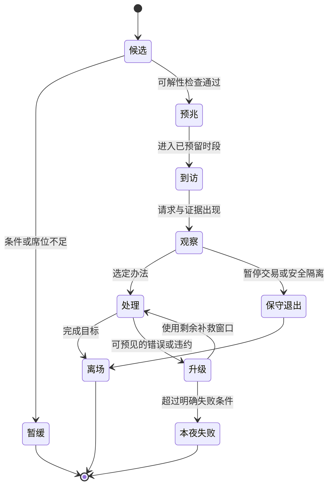

# 原型范围与验收

## 当前交付是什么

V0.2 是设计文档和结构化内容候选。`content/*.json` 可以用于后续编辑器导入、图鉴展示和内容检查，但其中的自然语言条件还不是可直接执行的怪物 AI。当前仓库未包含已能在微信内运行的客户端，也没有把设计检查当作实机测试。

目标是先验证一个问题：**玩家能否在做真实便利店事务的同时，依据观察、知识、资源和同伴安排，主动处理不同的异常？** 全部 60 个原型都需要独特的主要交互，不能只换立绘、商品名称或身份问答。

## 第一轮可玩范围

固定一张店面地图，完成全部六个夜班阶段和白天六格安排，再用三个连续日夜验证资源跨日循环。七天采用相同时间表；先实现三天不意味着正式版改成三天周期。

| 模块 | 第一轮范围 | 需要证明的行为 |
|---|---|---|
| 店面 | 收银台、两排货架、热食台、冷柜、验收台、后仓、休息点、前后门 | 玩家看得清线索和退路，绕行与岗位分配有实际价值 |
| 日夜 | 24 小时状态机；每游戏小时 120 秒夜班；白天选择后直接结算 | 七天复用相同阶段定义，没有按星期硬编码不同工种 |
| 主角 | 精力、SAN、饱腹、体力与少量离散异常状态 | 长期疲劳与短时耐力可区分；普通行走、撤离和基本交易不被体力归零锁死 |
| 人员 | 主角、一名同事、店长；指派一个当前任务与一个可取消后续任务 | 玩家有帮手；权限变化、任务接替和假扮证据可见 |
| 志怪 | F02 画皮、F05 河童、F08 付丧神、F12 不可杀伊、F13 飞头女鬼、F16 图尤尔、F23 塞尔基、F31 马拉、F36 精灵访客、F38 双重身、F53 水之母、F59 工队 | 覆盖外貌、湿路、维修、材料投喂、气味、现金、所有权、睡眠、契约、时间轨迹、库存与施工 |
| 事件 | 先从 72 项中实现 18 项，包括 E037 百鬼夜行及两种身份事件 | 有预兆、有选择、有收益或损失，并能合法插入固定阶段 |
| 准备 | 基础食物、SAN 恢复品、照明和隔离工具；每槽至少一项有取舍的装备；三花猫与纸灯灵 | 不抽到稀有物也有基础解法；宠物只补线索，不替玩家判身份 |
| 抽奖 | 完整概率、5 抽非普通与 10 抽稀有保底、跨周记录、库存溢出选择 | 展示前先确定并保存结果；重开界面不改结果 |

F14 附身属于进阶可选分支，默认禁用；它不属于首版“外形假扮”的必要范围。禁用时必须同时排除普通投放、事件替换和联动依赖。

## 2D 交互与手机操作

采用俯视或轻斜俯视的固定店面，第一轮不做 3D 镜头和复杂追逐。点击地面移动，点击对象展示最多三个上下文动作；需要持续工作的动作有清楚的进度与取消键。移动目标显示预计路线，危险地面或不明员工区权限要在确认前提示。

收银、验货、贴签、封袋、调岗、摆放供物与开关分区形成主要动词。世界中的气味、声向、足迹和水深必须有可开关的辅助显示；关键证据不能只依赖耳机、颜色差异或极小字体。普通触摸设备不要求连续精准点击，第一轮不给关键反制设置小于 1.5 秒的输入窗口。

HUD 显示可信班次时间、四项资源、当前阶段任务、同事岗位和待核请求。角色可能看到幻影或听到误导声，但可信手册、已确认的记录、资源数值和操作标签不随 SAN 被偷偷篡改。恐惧来自世界状态与选择后果。

切入后台与主动暂停都冻结本地单人遭遇，不补算离线攻击。返回时显示当前阶段、已确认线索与暂停前动作；这项是产品目标，具体微信运行环境与存储接口在客户端选型时按官方文档确认。

## 数据与运行逻辑分开

建议保留以下模块边界；这是实现建议，不是已经存在的代码。

1. **时间与资源：**统一游戏时钟、白天行动结算、夜间实时体力、资源上限和效果冷却。
2. **人物与权限：**真实实体、展示外貌、玩家已知信息、岗位任务、区域权限分别存储。
3. **证据：**线索的来源、可见方式、确认时间、独立性类别和不可变历史。
4. **遭遇：**每个 F 实例的预兆、到访、请求、升级、处理、离场及残留状态。
5. **导演：**先检查硬冲突、规则知识、可用反制、工作耗时、证据和退路，再计算压力与抽样。
6. **内容：**F/E/H/I/Q/P/S 编号的配置；民俗来源只负责说明创作依据，不作为运行时逻辑。

投放保证只针对**入场时的合法状态与至少一条可行路线**。玩家主动丢弃所有补给、解除所有隔离、违背明确契约后，不能仍承诺必定获胜。失败应能回溯到可观察的信息和选择。

## 条件联动怎么落地

每个怪物记录自身的加难、减难条件；`content/synergies.json` 另外给出一组可以直接讨论的组合卡。最终导演需要把这些文字翻译成条件谓词，而不是在运行时临时猜测。

条件至少要区分：同场实体、残留状态、天气、湿区或气味等环境、玩家知识、设备、员工任务、资源余量、契约义务。多人看见同一张被盗封签不是两类独立证据；同一个假扮者制造两通电话也不能计算成两个不同来源。

必须禁止的组合包括：唯一反制动作同时被禁止、唯一安全路线被封、两种必要证据同时不可用、强制睡眠和强制持续清醒同时生效、单人必须在不可同时到达的两处操作、应对最低成本超过当前可用资源且无免费保守退出。压力预算再低也不得绕过这些条件。

## 保存与跨周继承

保存字段至少包括：内容版本、随机种子与随机数位置、真实时间阶段、资源与延迟效果、角色真实身份、权限、已确认记录、怪物实例、事件预留、当前任务、物品与装备、宠物照料状态、学习进度、未到期契约、抽奖结果与两种保底计数。

读档恢复相同事实，不重新抽身份与奖品。咖啡后的精力回落、下夜的契约代价、未处理的库存隔离都必须随存档保留。跨周继续保留知识、合法获得的装备和物品、宠物关系、未到期合同及抽奖保底；每周重置的是周目标、评价、已完成的夜数和可明确补充的排班库存。

工资、夜班奖券与免费饭食都使用明确的领取记录：奖励以“存档周期＋周数＋夜数＋奖励类型”为唯一键，饭食以游戏日期为键。同一班次重试不重复发工资与奖券，领取记录随主存档保留；不能通过回到六点或反复结算增加物品。

普通失败允许重试本夜或回到班前准备。断点续玩恢复原种子与真实身份；挑战模式整夜重试也使用固定种子。基础模式可以在清楚提示、完整重置本夜尚未结算的遭遇与工作后选择新种子；抽奖结果、领取记录和长期解锁不随换种子回滚。退出损失只涉及本次未结算经营，不回收已经明确获得的长期解锁。具体结算时点在客户端实现前统一，避免“获得提示”和实际存档不一致。

## 验收与停止条件

| 检查 | 通过标准 | 当前状态 |
|---|---|---|
| 内容结构 | 60 个 F、72 个 E、20 个 H、24 个 I、24 个 Q、8 个 P；编号和引用无悬空 | 由仓库校验脚本检查 |
| 固定阶段 | 七天共享一套阶段；所有定时事件有合法窗口；没有隐形延长 06:00 的处理 | 设计约束已写入，待实现回放 |
| 四资源 | 同一时间的饱腹只扣一次；移交未食用食物只减库存；基础可恢复路径存在 | 设计审查完成，待模拟与试玩 |
| 身份 | 同事与店长均可假扮；首周同一时刻最多一个假扮者；至少两种独立证据才能恢复高风险权限 | 待客户端验收 |
| 抽奖 | 每个概率分支与保底优先级可枚举；断点恢复不重复发放；保底跨周 | 配置检查通过后仍需运行时测试 |
| 联动 | 对启用池逐个检查硬冲突；重点组合做有解/无解样例；F14 关闭时所有调度入口都跳过 | 待导演实现 |
| 玩法 | 初见玩家能指出预兆、采取动作、解释失败；同一场景有至少一种保守处置和一种收益更高的处置 | 待可玩测试 |
| 性能与触控 | 在确定的目标手机上测帧率、触控误操作、后台恢复和文本可读性 | 尚未测试，不声明实机达标 |

达到第一轮目标后再按机制族扩充怪物与事件，避免一次制作 60 套美术和行为后才发现核心操作不成立。60 个候选代表内容设计规模，最终启用顺序由可玩反馈决定。
