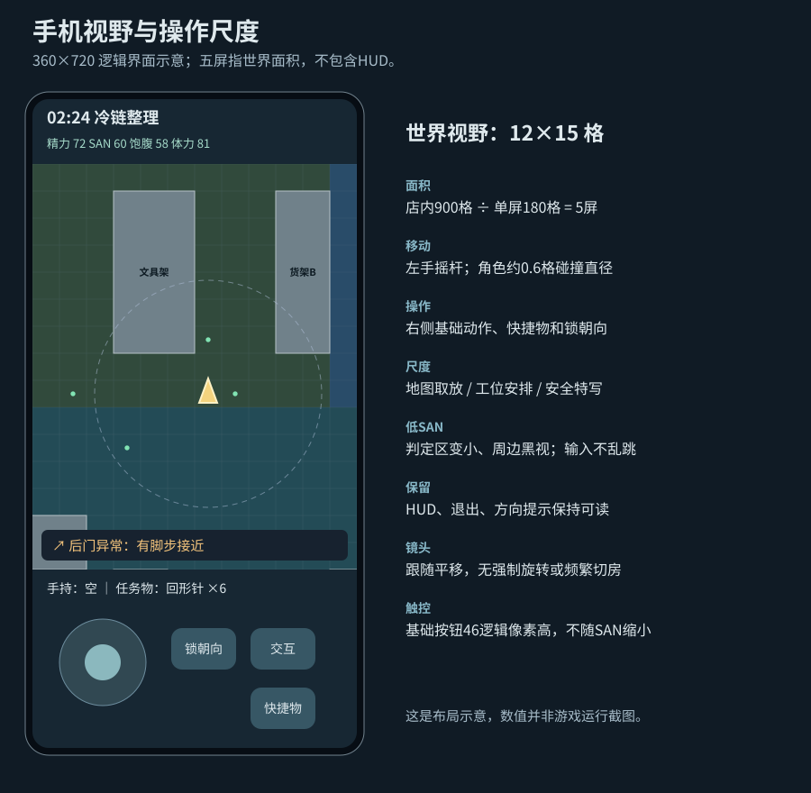
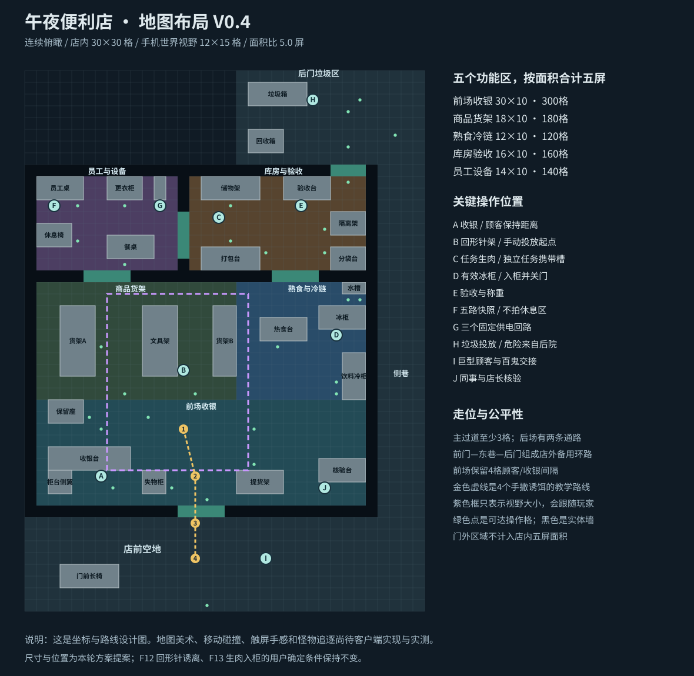
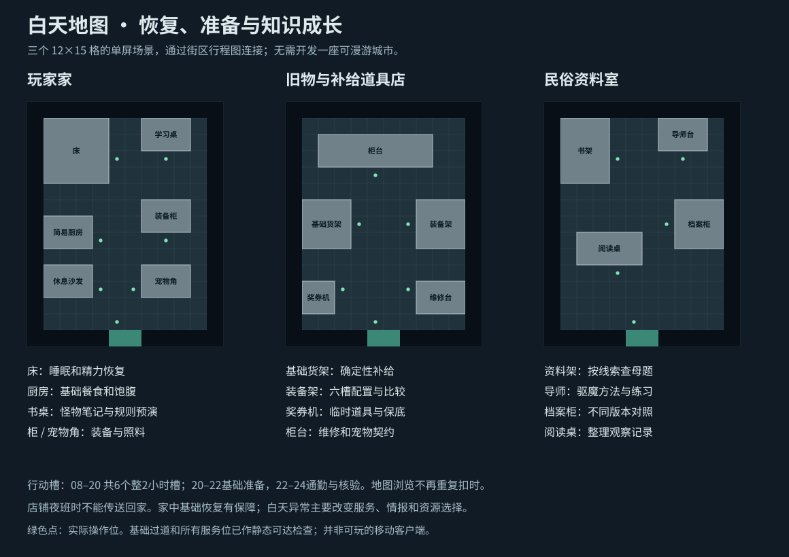

# 地图设计 V0.4

> V0.5底图尺寸保留，但机制物件、具名位置与湿区须合并[地图补件](22_map_mechanics_v05.md)。旧“主过道3格”不能理解为所有操作凹槽；后场存在宽体内部无法贯通的已知限制，见补件的半径探针。

## 1. 五屏如何计量

默认提案为竖屏。360×720逻辑界面中，顶部72像素用于状态，世界视图360×450像素，下方198像素用于操作与安全区。一个格子显示30像素，因此可见世界为12×15格，即180格。店内平面轮廓30×30=900格，900÷180=5个手机世界视野的面积。

“五屏”包含墙、货架和设备占地，不能误称900格全部可走。地图连续滚动；五个功能区不是五个切屏房间，也不是需要逐屏清怪的关卡。店外不计入五屏。不同手机保持基础世界可视范围与格距，额外高度用于界面；角色朝向独立于镜头，不因打开工位面板自动转向怪物。

普通走路3格/秒、一般重物2.4格/秒、生肉2.6格/秒。主过道至少3格，主要营业环路存在较宽交会处；主角碰撞半径提案0.3格。店门宽3—4格。距离规则全部用格子判定，不用屏幕像素。

## 2. 连续夜班地图

| 功能区 | 坐标范围（左上x,y / 宽,高） | 面积 | 核心工作与威胁 |
|---|---|---:|---|
| 前场收银 | 0,20 / 30,10 | 300 | 扫码、现金、取货、核验、顾客排队、距离型怪物 |
| 商品货架 | 0,10 / 18,10 | 180 | 补货、盘点、回形针、货架遮挡与两侧绕行 |
| 熟食冷链 | 18,10 / 12,10 | 120 | 熟食维护、生肉入柜、水槽、冷热区域与设备故障 |
| 库房验收 | 14,0 / 16,10 | 160 | 生肉、收货称重、打包、隔离、垃圾分袋 |
| 员工设备 | 0,0 / 14,10 | 140 | 班表、休息、更衣、监控、配电；两条后场出口 |
| 店前空地 | 0,30 / 30,8 | 240，额外 | 巨型订单、百鬼交接、F12诱离区、地面危险预告 |
| 后院垃圾区 | 18,-8 / 12,8 | 96，额外 | 垃圾与回收箱、固定排水沟、后门等候位 |
| 东侧通道 | 30,-8 / 4,46 | 184，额外 | 装卸点、门前到后院的备用路线、屋檐分段掩护 |

前场和商品区为开放销售空间；货架阻挡视线并形成环路，但不允许实时推动货架改变导航。两处后场入口由员工区与冷链区进入，后场横通道连接员工区和库房。正门—前场—东侧巷—后院—后门构成外环。关闭某个门只切换预置通路，不重建地图。

**三个尺度**：跑动、撒诱饵、搬肉、倒垃圾、开关门在大地图；查看班表、派工、旧监控截图是工位面板；计量、扫码、打包等精细动作从安全工位进入特写。特写冻结世界，开始前预留并显示一次操作成本，结算一次，不允许怪物在暂停期间暗中推进。

## 3. 为具体规则预留的空间

- **收银距离区**：收银操作位(6.5,26.5)，顾客等候位(6.5,22.5)，相距4格。在工作台上完成交易，避免“必须靠近怪物1格，同时又保持2.5格”的矛盾。柜台挡移动，视线是否被遮挡另用静态标签。
- **不可杀伊**：文具架操作位(13.5,17.5)。教学诱饵点(13.5,22.5)→(14.5,26.5)→(14.5,30.5)→(14.5,33.5)，邻点都在5格嗅探范围内。6次基础投放足够4点教学路线；最多3点同时有效，玩家随它吃掉诱饵再向前布置。点位是教学建议，不能在入场时免费生成。
- **飞头女鬼**：登记生肉位(16.5,4.5)，主冰柜交付位(26.5,14.5)。冷链通道关闭仍有员工区备用路径；只有备用路线与时限通过检查才启用该变体。饮料冷柜的备用任务容器功能须单独实现、登记和清空后才能启用，不能默认所有冷柜都能提交任务肉。
- **水系互相作用**：后院固定排水沟与店内湿格分组。保留塔尼瓦的通水沟时，可独立切断河童进入营业区的连接。水是预置格子的干/湿状态，不是流体模拟。
- **视线型怪物**：货架两侧、凸面镜、固定窗帘槽和提示屏槽供玩家选择遮挡路径。镜面只显示预设角度和状态，暂不做真实反射渲染。
- **巨型与群体怪物**：大型来客留在前场交接；F54只显示店外巨口和取货绳槽，不制作可探索的怪物腹内地图；百鬼夜行使用前场及服务窗分批交接，不让60个实体同屏寻路。
- **离屏提示**：边缘方向箭头、脚步/旋律图标、危险倒计时不被SAN黑视遮住。音效有等价文字或图形提示。不得在屏幕外无预警瞬移到玩家身边。

42个门店操作锚点与8个固定部署槽已登记在`maps.json`。任务变体可以重绑已登记锚点；进入营业中的随机事件不能把必要物件改放到不可达格子。宠物停在工作站或作装饰跟随，不增加一套复杂碰撞寻路。

## 4. 路线预算与拒绝不公平组合

下表为四邻接静态网格的最短路线，只含走路/搬运时间，不含怪物阻拦、拿放、等待、QTE和补救。报告由[validate_maps.py](../scripts/validate_maps.py)从坐标重算。

| 路线 | 长度 | 移动时间 | 设计含义 |
|---|---:|---:|---|
| 验收台→主补货位 | 29格 | 12.08秒（重物） | 两次补货需事先预留回程，不把搬运当瞬移 |
| 任务肉→主冰柜 | 20格 | 7.69秒（生肉） | 另加取肉0.6秒、存入并关门0.6秒及补救 |
| 封袋台→垃圾箱 | 16格 | 6.67秒（重物） | 常态清运可落在03—04阶段 |
| 回形针架→正门店外 | 17格 | 5.67秒（空手） | 此值不含诱导等待，不能拿来当怪物通关时长 |
| 柜台→配电→柜台 | 60格 | 20秒 | 电路事件至少给够往返和维修窗口 |
| 后门关闭，封袋台绕外环→垃圾箱 | 88格 | 36.67秒（重物） | 这是应急路线，不能同时塞满90秒怪物任务 |
| 冷链通道关闭，任务肉→冰柜 | 36格 | 13.85秒（生肉） | 需要重新核算追逐距离与剩余阶段预算 |
| 柜台→货架→热食→库房→员工桌→柜台 | 106格 | 35.33秒 | 五屏地图不应要求每分钟整圈巡检 |
| 巨魔两批搬货、回程和结账 | 144格 | 54.83秒（混合速度） | 路线预留56秒，完整遭遇含操作和补救85秒 |
| 双重身的终端和三处工作记录核验 | 89格 | 29.67秒 | 路线预留35秒，三步记录须在异常前已经存在 |

调度器实际准入时必须从玩家当前格和已占用工位重算，不能把上表当对任意位置的承诺。必须预留必要营业、实体操作、提示和一次补救。后门故障时优先安排现场开锁；若采用外环清运，则降低该小时怪物负载，或者推迟可选异常。没有剩余预算就不投放。

首轮同时主动追玩家的怪物最多一只；F12/F13禁同时。禁止在追逐已开始后新增锁门，或把唯一有效冰柜关闭。固定装置只改变速度、可见度、提示或短时保护，不新增路径阻断。

## 5. 白天三张单屏地图与行程图

**玩家家（12×15格）**：床用于睡眠与复盘；厨房领取基础餐并进食；学习桌阅读笔记、预演动作；装备柜装配；宠物角照料；沙发用于短休与SAN恢复。家是稳定的恢复场所，噩梦事件改变日间反馈和可选行动，不封锁睡眠、免费食物或基础恢复。

**道具店（12×15格）**：基础补给、装备架、奖券机、维修台、柜台和宠物契约。必需解法用品由岗位保证；商店出售确定性补充和升级。奖券用于临时道具，显示保底状态。买装备可在比较界面检查占手、槽位和收益。宠物采购/领养通过柜台服务，不扩建一座独立宠物城。

**民俗资料室（12×15格）**：书架按线索与地域查资料，导师教驱魔方法，档案柜比较来源版本，阅读桌整理观察。学习给提示、练习和约定的效率收益；首次必遇怪物的基础方法要在入夜前免费告知，不能靠购买资料避免必死。

**街区行程图**是节点菜单，连接家、店、道具店、资料室，不是第五张大开放世界地图。08—20有6个整2小时行动槽；服务和路程一并算入行动槽。20—22的基础采购归入准备，22—24通勤与核验。浏览场景不再暗扣时间，随机交通事件也不创造半槽。夜班期间只能活动于门店及连续外部空间，不能瞬移回家补SAN。

## 6. 制作顺序

先用同一图块集实现夜店灰盒、三个白天单屏和菜单旅行。下一步完成碰撞、摄像机跟随、固定工位与门状态，再把F12/F13接进实际地图验证追逐。只有实际移动与遮挡通过后，才逐步开放需要声音窗、快照、区域图的怪物。地图图纸和静态寻路检查不替代引擎碰撞、怪物AI和手机实机验证。

## 7. 短窗口操作的精确落位

16组固定附件挂在现有工位，不扩大地图或新增复杂场景。其中下列位置用于避免“纸面时间足够、实际跑不到”的问题。

| 遭遇 | 局部布置 | 完整窗口约束 |
|---|---|---|
| F10 | 后门小窗操作(27.5,1.5)，近侧排水杆(27.5,2.5) | 往返2格＋两次1秒动作=2.67秒，小于6秒看卡窗 |
| F12 | 备用文具领取(9.5,17.5)；教学怪(8.5,22.5)，玩家(13.5,19.5) | 出生距离5.83格满足至少5格；备用槽独立于B05 |
| F32 | 箱体放柜台顶(8.5,25.5)，玩家(8.5,26.5)，挡板控制(7.5,26.5) | 箱放妥才启动4秒，1格到控制＋0.6秒关板=0.93秒 |
| F40 | 路标(14.5,19.5)、(10.5,19.5)、(8.5,22.5) | 相邻直线距离不超过4格，地标不改变物理路径 |
| F50 | 前场窗操作(18.5,30.5)/(22.5,30.5)，板在(20.5,30.5)；后场另有一组 | 一次只选一组；最多12格准入路径＋2秒推板＋撤离分别7.33/6.67秒，均≤8秒 |
| F52 | 椅边湿格(4,3)/(4,4)/(4,5)，检查位(4.5,6.5)，干站点(5.5,6.5) | 独立短支线，至椅≤4格；不要求拖完整后院水路 |
| F57 | 本地杆(27.5,-3.5)，过箱线(27.5,-4.5)→(29.5,-4.5) | 含停水、放板、搬箱、落箱、收板和复位5.22秒，≤8秒 |

F06雪女顾客位(23,25.5)，玩家取物位(19.5,25.5)，相距3.5格；F17裹尸鬼位(21.5,6.5)，玩家(17.5,6.5)，包裹(18,6.5)，分别满足4格距离和0.5格取物。以上为静态格子验证，正式客户端仍需验证碰撞半径、动画和手指响应。
