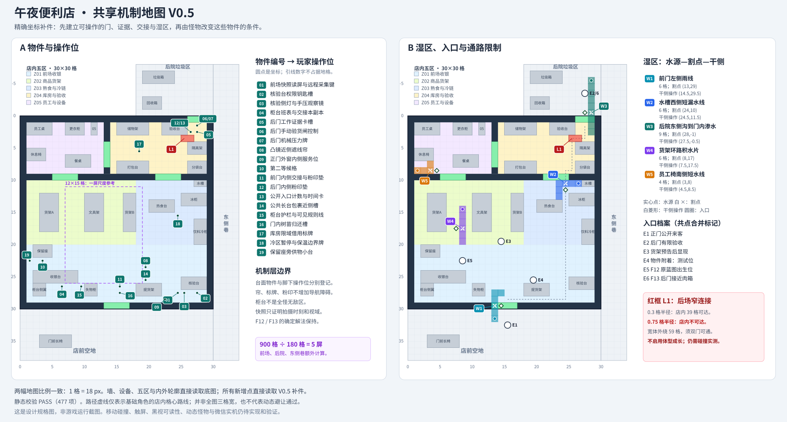

# V0.5 地图机制补件与落地边界

本文件把便利店的共享机制落实到可以定位的物件、操作位和湿格。数据见 [map_mechanics_v05.json](../content/map_mechanics_v05.json)，检查见 [validate_map_mechanics_v05.py](../scripts/validate_map_mechanics_v05.py)。

这是基于 Claude [PR #1](https://github.com/6b72p5646w-cyber/Ruler-Control/pull/1) 的地图审查和 [PR #2](https://github.com/6b72p5646w-cyber/Ruler-Control/pull/2) 的店铺机制提案所做的具体修订。原 [maps.json](../content/maps.json) 继续提供底图；本补件提供 V0.5 物件绑定。旧图纸尚未绘出这些新增槽位，不把底图示意当作所有交互已实现的证明。



[查看 PNG 大图](maps/store_mechanics_v05.png)。两幅面板使用同一尺度；左图用编号标记 19 个操作位，右图分开标记水源、割点、干侧操作、入口档和后场窄连接。图例位于地图之外，几何直接来自底图和补件数据。

## 1. 五屏空间保留，交互各有落点

店内轮廓仍为 30×30 格，基准世界视野为 12×15 格，面积比为五屏。前场、后院垃圾箱和东侧巷仍是额外连续空间。家、道具店、资料室保持原布局。

本次补入 19 个物件、12 组具名位置、5 个离散湿区、2 组室内防窗操作位及 6 个入口档。物件大多附着在已有台面、墙、地面或门上，不新增静态导航障碍。原来一个 `floor_markers` 被多个怪物当作不同位置的问题，改为明确的坐标组；只有列希仍引用其原有三标记。

地图只定义“这里有什么、可以怎样操作”。门牌、帘、镜、干格和柜台是否能阻止某只怪，必须由该怪已登记的规则决定。柜台不会因为多了可见边界就变成全怪无敌区；不可杀伊的追逐条件不会被这个补件覆盖。

## 2. 共享物件：设备在台上，人站在地上

坐标均为格心，`object_position` 可以在柜台或墙面，`player_position` 必须可走。表中坐标是玩家操作位，完整物件坐标与状态在 JSON。

| 物件 ID | 操作位 | 机制用途 |
|---|---|---|
| OBJ_VERIFY_READER | (24.5,27.5) | 前场读屏与远程采集键；一次采集用 1 秒世界时间 |
| OBJ_VERIFY_KEYS | (27.5,27.5) | 将钥匙、权限与外貌辨认分开 |
| OBJ_VERIFY_LAMP | (25.5,27.5) | 有免费手压观察模式，供电模式是额外帮助 |
| OBJ_COUNTER_ROSTER | (6.5,26.5) | 柜台直接读取已核验班表和交接本副本 |
| OBJ_REAR_EVIDENCE | (27.5,2.5) | 在后门取本班已存在的工作证据卡 |
| OBJ_REAR_GATE | (27.5,1.5) | 后门开口、交单缝与关闭状态 |
| OBJ_REAR_GAUGE | (27.5,1.5) | 机械压力牌，与声音远近形成两路信息 |
| OBJ_MIRROR_CURTAIN | (19.5,23.5) | 凸镜旁的固定遮线帘，只改规则视线，不改寻路 |
| OBJ_FRONT_SERVICE | (22.5,28.5) | ATT01 的店内服务操作位；不需要走到门外交易 |
| OBJ_SECOND_QUEUE | (3.5,22.5) | 座位保留时可实际切换的第二等候格 |
| OBJ_HANDOFF_MAT | (15.5,26.5) | 门内交接、粉印与中立物件交付 |
| OBJ_REAR_POWDER | (26.5,2.5) | 后门足迹核验 |
| OBJ_ENTRY_TALLY | (26.5,2.5) | 有时间范围的入口事件记录 |
| OBJ_PUBLIC_PARCEL | (19.5,25.5) | 裹尸鬼的公共提货台；访客不用进入库房 |
| OBJ_COUNTER_BOUNDARY | (9.5,26.5) | 可见柜台边界标记；按怪物规则决定作用 |
| OBJ_TREE_RETURN | (15.5,27.5) | 列希的门内树苗归还槽 |
| OBJ_LEASE_MARKER | (18.5,5.5) | 精灵访客借用库房范围和期限的标牌 |
| OBJ_COLD_SECTION_SIGN | (24.5,15.5) | 冷区暂停、保温边界与可用路线提示 |
| OBJ_OFFER_TABLE | (1.5,22.5) | 家宅访客的实际供物槽，消耗真实库存 |

### 核验集中后的证据边界

前场读屏能够发起一次远程采集，消除“只把屏幕搬过去，拍照还必须横穿全店”的残留问题。免费开场快照与实体检查保留；额外采集是否花电由共享电力系统决定。

快照记录拍摄时刻、摄像区和可见物体。它不证明镜头外的情况，也不证明未拍摄的二十分钟里某人一直在柜台。工牌、脚印、正常外貌和真实快照都不能单独授予员工权限。核验便签作者时，必须有覆盖写入时刻的位置证据；“作者在上班”不能替代“作者在写字的位置”。

前场终端不会变成永远正确、自动标红的测谎器。是否采到了所需证据、两个记录是否来自独立来源、玩家有没有查看，是另外的运行态条件。

### F17 的公共交付

操作位为 (19.5,25.5)，包裹位为 (20.5,25.5)，访客等候位为 (23.5,25.5)。玩家够得到包裹，与访客相距 4 格。访客在玩家离开包裹至少 2.5 格后才能靠近领取。这避免了原卡把访客直接放进员工库房的权限歧义。

## 3. 湿区是格子开关，不是流体模拟

前门、水槽和后院分成三片独立区域；另给邦耶普一片货架积水、托科洛舍一条椅下支线。默认只激活一个水域主机制。更高难度若要叠加，必须另查干路、提示负荷与导演预算。

每区都登记水源、目标格、关键割点、干侧操作点和安全点。擦断关键格后，和水源失去连接的目标分支排干。水只是规则状态，不改变底图碰撞，也不自动吞掉所有在水上的工作收据。

| 区域 | 离散格数 | 关键割点 | 干侧操作位 | 主要用途 |
|---|---:|---|---|---|
| WET_FRONT | 6 | (13,29) | (14.5,29.5) | 门槛雨线、湿地节拍、门外交付 |
| WET_COLD | 6 | (24,10) | (24.5,11.5) | 水槽西侧拖物、音源分支 |
| WET_REAR | 9 | (28,-1) | (27.5,-0.5) | 后院水沟与门内渗水 |
| WET_AISLE | 6 | (8,17) | (7.5,17.5) | 货架环路的测深、划界和干侧取物 |
| WET_CHAIR | 4 | (3,8) | (4.5,8.5) | 休息椅南侧水线；不经过值班板 |

冷链湿线避开水槽、阀门唯一的干侧入口。不能把整个 `(26–29,10–13)` 矩形设为湿区，因为其中既有设备和墙，也有阀门的操作凹位。后院割点不切断塔尼瓦要求保留的上游水沟。椅下水线不再占用 `staff_desk` 的 (4,3) 格。

检查逐区验证：湿格在可走地面；水源与目标起初连通；擦掉割点后断开；玩家能从干路到操作位；割点在够得到的范围内；必要工位仍有干路。没有把“节点在地图上存在”当作“从干侧一定能操作”的证明。

## 4. 专用位置有名称，避免泛用地标替代真实坐标

| 点组 ID | 使用目的 | 坐标 |
|---|---|---|
| GRP_CASH_TRACE | 图尤尔的三处现金痕迹 | (9.5,23.5)、(10.5,23.5)、(12.5,24.5) |
| GRP_RED_TRACE | 红帽妖伤迹 | (6.5,23.5)、(9.5,23.5)、(14.5,24.5) |
| GRP_LURE_RETREAT | 古尔门外后退点 | (15.5,32.5)、(15.5,34.5)、(15.5,36.5) |
| GRP_BATCH_TRACE | 逆足林守的批次轮迹 | (17.5,3.5)、(20.5,3.5)、(23.5,3.5) |
| GRP_TOOL_TRACE | 萨西的失物与风迹候选 | (17.5,4.5)、(20.5,4.5)、(23.5,4.5) |
| GRP_GIANT_BUFFERS | 吞世巨兽取回物暂存 | (19.5,32.5)、(20.5,32.5)、(21.5,32.5) |
| GRP_ESCORT_ROUTE | 卡德霍一段门前护送 | (15.5,31.5)、(15.5,34.5)、(15.5,37.5) |
| GRP_CONSTRUCTION_SLOTS | 梅内胡内三份材料 | (9.5,21.5)、(10.5,21.5)、(11.5,21.5) |
| GRP_LESHY_MARKERS | 列希原有三路标 | (14.5,19.5)、(10.5,19.5)、(8.5,22.5) |
| GRP_FRONT_SAFE_LINE | 前门内侧规则线 | (14.5,28.5)、(15.5,28.5)、(16.5,28.5) |
| GRP_REAR_SAFE_LINE | 后门内侧规则线 | (26.5,1.5)、(27.5,1.5) |
| GRP_DRY_HANDOFF | 门外交付的干侧位置 | (15.5,31.5)、(16.5,31.5) |

点组是候选实体位置，不表示所有点必须巡回一遍。怪物规则应写出当前使用哪个点、何时激活、是否需要玩家靠近。古尔的门外后退点只是声源位置，不能因为它们有坐标就给玩家新增必须到达的工单。

## 5. 泽西恶魔的上板改到室内

原后窗若直接把 y=-0.5 改成 y=1.5，会落在验收台阻挡区。本补件重新选取同墙面的两个窗口，没有只改纵坐标。

| 档案 | 室内操作位 | 取板位 | 撤离点 | 完整动作上限 |
|---|---|---|---|---:|
| DEF_FRONT_PAIR | (22.5,28.5)、(24.5,28.5) | (23.5,28.5) | (23.5,25.5) | 7.33 秒 |
| DEF_REAR_PAIR | (20.5,1.5)、(21.5,1.5) | (21.5,2.5) | (21.5,3.5) | 7.00 秒 |

计算包含：玩家到板再到目标的最多 12 格路径、2 秒推板和从目标到安全点的路径；均在 8 秒预告内。若当前玩家位置到取板再到窗超过 12 格，导演不能启动这一轮俯冲。每次只启用一组。俯冲条带留在店外，帘和板沿固定槽工作，不允许自由搭墙封路。

## 6. 入口档与运行态准入

| 入口档 | 适用情形 | 主要约束 |
|---|---|---|
| EP_FRONT_VISITOR | 正门顾客、公开来客 | 前门当前可通，停留在公共区 |
| EP_REAR_DELIVERY | 后门送货、有限验收 | 后门可通；入员工区不自动获得权限 |
| EP_AISLE_MANIFEST | 货架区预告后显现 | 屏外方向提示，当前格和退路再检查 |
| EP_OBJECT_MANIFEST | 座椅、货物、镜等物件附着 | 按已登记物件位置实例化；公共提货位只是测试档 |
| EP_F12_RESERVED | 不可杀伊 | 保留原详细蓝图的出生位和默认追逐 |
| EP_F13_REAR | 飞头女鬼 | 从后门已登记路径接近肉箱；肉箱被搬走则跟随当前位置 |

各档都有静态可达的节点。敌对效果激活前仍必须检查玩家距离、当前门状态、必要工作与逃生路线、剩余阶段预算及追逐数量。至少 5 格的激活距离是运行态约束，静态坐标表无法证明它对任意玩家位置成立。

太近时先发可辨方向的预兆并延期激活；仍不具备条件则换已登记入口或延后遭遇。不能用“随机找一个空格”把怪物直接放在玩家背后。飞头女鬼的目标是当前登记肉箱，入口路径不会把肉箱重新锁回库房；其接触转追、送入有效冰柜即解除的规则保持原蓝图。

## 7. 通道宽度：把已经证明的范围说清

四段明确主通道通过了矩形检查：西货架间 4 格、中央货架间 3 格、货架南横廊 3 格、前门纵向通道 4 格。设备旁和墙边的服务凹位另外登记，不能统称为三格主路。

一次半径探针发现了额外限制：

| 探针 | 结果 | 对设计的含义 |
|---|---|---|
| 半径 0.3，前门到后门，只走店内 | 39 格可达 | 符合当前基础角色的静态路径条件 |
| 半径 0.75，货架环路 | 11 格可达 | 仅证明这段局部宽路 |
| 半径 0.75，前门到后门，只走店内 | 不可达 | 后门验收和隔离架之间存在窄连接，不能支持随意放大碰撞体 |
| 半径 0.75，允许店外东侧巷 | 59 格可达 | 必须双门可通，并额外预算外绕时间 |

因此本版追逐仍使用已登记的 0.3 格碰撞半径，不加入不可杀伊吃铁变大或宽体怪挤进必经内通道的规则。这个限制以 `known_geometry_limits` 和准入条件保存。检查返回 PASS 的意思是“数据与写出的限制相符”，不表示宽体内路已经修通。

这些是格心导航上的静态半径探针，仍需客户端验证移动碰撞、转角和触屏误差。F12/F13 的已有精确规则测试也不能代替这些实机工作。

## 8. 本地路线结果与检验命令

| 补件检查 | 实际移动 | 修订作用 |
|---|---:|---|
| 收银→柜台班表副本→稳定区 | 0.67 秒 | F21 不再为读点名横穿员工室 |
| 后门窗→本地证据槽→后门窗 | 0.67 秒 | F10 不再强制 30.67 秒柜台往返 |
| 核验台→读屏→钥匙槽→核验台 | 2.00 秒 | 常用核验在前场完成 |
| 凸镜→近侧帘→凸镜 | 0.67 秒 | 视线规则有实际够得到的遮挡 |
| 提货架→公共包裹槽 | 0 秒额外走位 | 原工位即可操作，仍需完成包裹动作 |

表中只计算移动，不把读证据、调岗、停机和怪物反应时间混为零成本。F21 的完整事故窗口仍要把危险工位、同事实际位置和停机动作计入。

```sh
python3 scripts/validate_map_mechanics_v05.py
python3 scripts/render_map_mechanics_v05.py
inkscape docs/maps/store_mechanics_v05.svg --export-type=png --export-filename=docs/maps/store_mechanics_v05.png
```

当前检查为 PASS，477 项，涵盖位置引用、操作距离、干侧可达、湿线割点、保护水源、前后室内上板、入口节点、局部路线、四段主路与半径限制。脚本不会写回旧地图或旧报告。

尚未验证：动态人群避让、每帧攻击碰撞、任意多事件组合、黑视下的真实可读性、五屏触控追逐以及微信实机性能。新增附件是可实施的规格与静态数据，尚未安装为可玩的客户端。

### F60遮挡线的精确定义

OBJ_MIRROR_CURTAIN的规则遮挡线段为(18.5,23.0)—(20.5,23.0)，不阻挡导航。静态见证位置为玩家(19.5,23.5)、怪物(19.5,21.5)，闭帘遮断这条实体视线；只盖住镜面不算。实际实体走到帘同侧后须重新测视线，玩家仍可用朝向锁定背向移动。此检查只是一个可成立的局部摆位，不声称帘遮住全店。

### 局部面板与窗内冲击区

F28的三支路选择器共用现有water_valve工位及局部面板，不新增三个未登记站位。F50俯冲带在店外，但目标窗内侧玩家操作格同时登记为离散冲击格；安全撤离点不在其中。上板预算另预留0.25秒放下手持物，前/后组上限分别7.58/7.25秒，仍在8秒警告内，实际接近路线仍须运行态检查。
