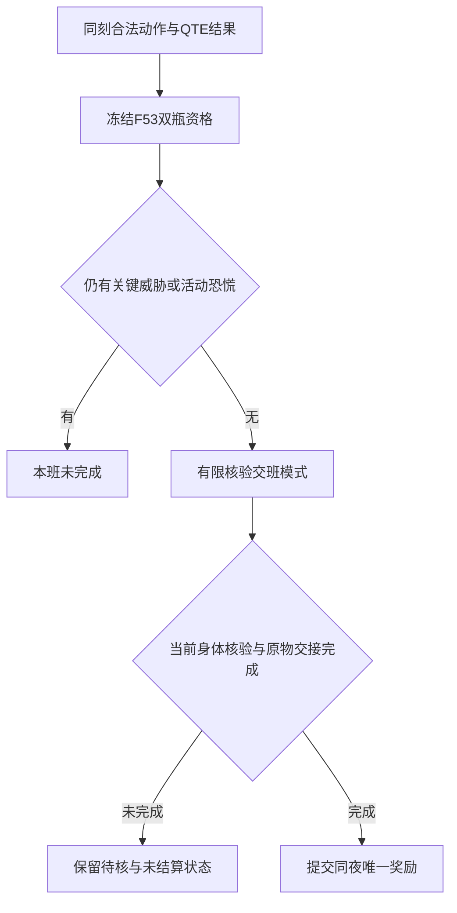

# V0.9 运行集成审计：让动作、资源和交班使用同一事实

2026-11-18。本轮继续检查前几轮独立参考接在一起时会出现的问题，并把两项核心动作放到现有地图上实际运行。网页切片提供F12不可杀伊、F13飞头女鬼两项独立练习与有限日间规划；完整正式夜班、六怪切片的其余四怪、60怪导演和微信发行包仍未完成。

本轮不是增加另一份怪物名单。重点是解决：每个模块单独成立，但日历、SAN、物品、F53资格、店长核验或奖励账由不同模块分别解释时，是否还会得到一致的结果。

## 一、当前结果分为三条实际流程

| 流程 | 当前已接入 | 明确边界 |
| --- | --- | --- |
| 两怪网页版练习 | 现有MAP_STORE底图、真实移动与碰撞、取放与有限世界动作、F12/F13精确蓝图、条件与四资源协调、暂停和终态 | 每次一个已编排练习，最多一只主动追逐者；没有完整顾客、店长和六波随机夜班。 |
| 日间规划 | 六个2小时格、部分已定义行动、学习页、常规采购、整备与通勤、同物消费和咖啡债务；执行器另支持已有案例结算 | 网页暂无真实案例采集来源，A04不提供可执行入口；A07/A08缺世界目标执行器时不开放、不收费；日间地图自由行走与完整宠物照料尚未接入。 |
| 正式交班有限适配 | 条件、营业、双瓶消费者、店长基线/当前比较、实际交接回执、工资奖券去重账 | 已可运行并接受针对性验证，但没有接进网页完整夜班；物理观察和交付事实仍由外部世界执行器提供。 |

当前权威数据为[integration_v09.json](../content/integration_v09.json)，两怪仍读取未修改的[精确蓝图](../content/encounter_blueprints.json)。设计目录的60个正式运行开关继续关闭；两项练习通过显式练习入口加载，不等于开放全部正式候选。

构建命令：

```sh
python scripts/build_playable_v09.py
```

结果为[playable_v09.html](../prototype/playable_v09.html)，具体操作见[试玩指南](28_playable_slice_v09.md)。本页只说明运行事实和接口边界，最终检查结果统一见[验证说明](09_validation.md)。

## 二、统一日历，避免白天和夜班各算一次或漏算一段

前几轮已经规定清醒、睡眠和夜班基础消耗，但知识、商品、条件与营业参考没有同一个24小时执行入口。只把各函数接到按钮上，容易漏掉早餐、整备和通勤的饱腹消耗，也容易把行动表里的饱腹说明当成额外扣减。

现在[日夜资源适配器](../prototype/day_cycle_core_v09.mjs)记录绝对游戏分钟，日历只由已完成动作或实际提交的夜班预算推进：

- 一格白天行动推进120游戏分钟，共6格。
- 夜班每2秒营业预算对应1游戏分钟，720预算秒对应六小时。
- 世界推进与已开始精度操作的合法预算成本都会消耗夜班基础精力和饱腹。
- 系统暂停、只读阅读和冻结的世界不产生体力恢复。
- 20:00—22:00整备保持120分钟，其中可选整备使用既有60分钟额度，剩余基本整备也真实计入日历。
- 22:00—24:00通勤验岗和06:00—08:00晨间按已有清醒速率计算，不消失为免费时间。

白天睡眠只按每游戏小时1饱腹，其余清醒按每小时3；夜间基础精力每小时4。八小时睡眠、十六小时清醒的一日，基础饱腹消耗恰为56。行动表的“睡眠/清醒速率”只选择一次适用速率，不再额外扣一份。

绝对日历不是另一只在后台独自运行的时钟。局部QTE、世界时间和营业预算各有职责；日历只是把实际已提交的白天动作和夜班预算映射到同一条时间线上。普通顾客耐心仍只使用实际世界时间，不能把冻结特写的预算成本当成顾客暗中又等了一遍。交班适配器采用现有每阶段第10/55秒的固定客单计划，共6笔窗口领取和6笔需实际过门的浏览单；开始服务后，到真实世界完成时刻才结单。按实际服务完成点分段，大步进不会把本已完成的服务误算为顾客耐心超时。它仍是有限营业适配，网页尚未展示这些顾客。

## 三、咖啡债务有精确到期时刻，并跨日保存

I05旧文案“下一游戏小时精力−8、SAN−2”没有说明是下一整点还是完整一小时后，也没有执行器负责跨06:00或一整格睡眠时的到期。这会使同一饮用动作因入口不同得到不同后果。

当前定义为：对同一份实际拥有、已核验且未被占用的咖啡，消费时先结算精力+12，并登记**实际消费时刻加60游戏分钟**的债务。每份物件有独立债务编号和已结标记，不能通过换一个消费回执再次创建收益或免除债务。

例如05:50饮用，债务在06:50到期；06:00不提前收取，也不清空。若它在一格睡眠中到期，先结债务，再提交这一格完成时的休息收益。同刻也保持这个顺序，防止通过资源先封顶、再遗漏扣减改变结果。

保存保留未结和已结债务、原物消费与日领记录。恢复同一份状态不会把已饮咖啡变回完整物品，也不会重发当天岗位餐；生产级外部回滚防护仍需要与正式战役持久化共同实现。

I03、I05、I13、I14已有文案中的资源数值已变为机器字段。I20没有个人资源恢复数值，因此当前资源模型不会把净水凭空换成饱腹；净水若用于清洁或特定交付，须由那个实际动作消费。茶的安全工位3秒和便当的安全食用条件仍保留，当前两怪快捷用品入口不绕过它们。

## 四、夜间SAN和恐慌只认一个主值

独立参考原本各自有资源对象。若消费者吃糖只改了自己的SAN，条件控制器可能仍在恐慌；反过来，界面或算分可能读取另一份尚未扣减的SAN。单项测试通过不能自动避免这种接线错误。

本轮明确状态归属：

| 状态 | 主值所属模块 | 其他模块如何使用 |
| --- | --- | --- |
| 夜间SAN与恐慌 | `condition_core` | 实际受击、物品、咖啡和已赚奖励提交带来源的差额；提交后同步镜像。 |
| 白天SAN、精力、饱腹、体力、个人库存、咖啡债务 | `day_cycle_core` | 入夜交接当前值；夜间SAN重新以条件控制器为准，其他资源继续实际计时。 |
| 位置、路线、碰撞、持物、怪物目标与动作进度 | `world_core` | 只有已经实际推进和完成的动作才产生回执，不从请求路径提前补事实。 |
| 普通顾客耐心与服务进度 | `store_core` | 只接收实际世界增量；精度冻结不能暗中推进顾客。 |
| F53同两瓶的资格 | `consumer_core` | 条件模块可负责封存工作持续时间，但不另用旧单物状态授予资格。 |
| 正式工资与奖券 | 稳定战役/夜晚账本 | 不按临时尝试ID重新发一份；界面只展示已提交结果。 |

新SAN提交入口按来源区分真实受击、已核验用品、咖啡债务、短休失败、宠物效果和交班后收益。损失来源不能伪装成恢复；同一回执重复提交不再产生变化或刷新恢复保护。来源分类与符号检查不是物理真实性认证，实际动作仍需世界执行器提供。

真实攻击后果不能误套被动恐怖观察的单实体冷却/上限。否则怪物接触累计达到观察上限后，玩家会得到没有设计依据的持续接触豁免。已有恐怖观察上限继续只管其原来的观察来源。

## 五、真正06:00的QTE结果必须先于危机判定

本轮发现的接线风险是：一个已开始的8秒预算QTE在预算712进入，退出正好到720。若先切换交班模式，再应用实际失败SAN损失，这份损失可能被“交班不接受新战斗效果”拒绝，或在算分后才出现。

已完成局部操作的结果属于同一次边界提交，当前处理为：验证同一次尝试与成本，提交预算和实际SAN结果，再派发恰好到达的日程边界。F31的真实失败、P08补偿与成本通过同一适配事务处理；不能用先后两个互不关联的调用把SAN损失漏掉。

真正06:00的顺序如下：



F53到720只冻结资格；它的SAN+5仍在安全核验交班之后支付。不能先用将来的SAN奖励消除当前恐慌，再宣称满足交班。720之后补封瓶子、新吃恢复品、补做普通订单或从补给柜取物，也不能修补已经错过的世界动作。

## 六、F53从两套判定收敛为同一两瓶的事实

早期条件参考保留一个用于演示到期顺序的单物承诺；后来消费者已经使用完整的6瓶/2保留/4可售合同。如果集成时同时运行两种判定，可能出现单物示例判履约而双瓶状态未满足，或同一夜被两处发奖。

当前正式交班适配器拒绝旧单物F53路径。接受时必须绑定实际同两瓶与同一保留容器；放瓶、封存和到期都沿用这些实例。两瓶同时在原保留容器且实际封存动作完成，才产生可被720快照读取的状态。工作容器可以有自己的操作进度，资格只从双瓶消费者读取。

普通销售仍不能拿走受预约保护的两瓶，玩家可以按既定取消分支放弃未赚奖励。移入一瓶、换成同名新瓶、仅把容器标为完成或720后补封，都不能取得原合同资格。整个流程继续使用已有有限库存与动作，不另造一份“奖励用水”。

## 七、店长到场、身份核验、交付和领奖分别成立

预算700对应05:50，是店长排程到场时刻。这个时间事实只说明可以出现核验机会，不自动证明画面中某一身体是真店长，也不代替钥匙和账目的交接。

有限交班适配器使用下列已有信息：

1. **班前真实基线。**私人约定与身体观察基线须在班前已存在，不能等到交班时补造答案。
2. **当前身体到场。**实际观察绑定一个身体实例；预算700的标记本身不生成可用的身体证据。
3. **两类独立比较。**同一当前身体的私人约定比较与身体基线比较，各有不同根来源与证据域，并与保存基线相符；同源重印不能凑数。
4. **连续性。**当前身体离开视野、替换或超过当前观察有效范围时，旧核验失效，不能拿过去快照自动续权。
5. **实际交付。**向同一仍被核验的身体交付已经声明的原钥匙与账目对象，才提交交班。

基线泄漏或比较不匹配时保留待核；没有通过就不支付工资，不强制玩家猜人。当前适配器检查已提供回执的来源范围、对象、比较值与连续性；尚未实现会自动产生这些观察的完整店长NPC、对话或伪装画面，不能把传入`verified`当作已经完成世界识别。

## 八、重试不能重新领取同一夜的工资和奖券

`runId`表示某次尝试。若把正式奖励键也绑定它，失败重开或重新构造会话得到新`runId`后，就可能再次领取同一夜奖励。

当前正式账本使用稳定的`campaignId + nightId`作为奖励键。一夜的合法经营结果、工资、奖券、F53交班后SAN收益和交班回执在一个同步事务中登记。已登记过同一战役/夜晚，再完成一个新尝试也返回原结算信息，不增加金币、奖券或第二份SAN奖励。工资与奖券仍按既有真实工单/客单数量计算，不因身份核验成功就自动取得最高评级。

账本可以序列化与恢复。生产环境必须将该账本和战役资源检查点共同原子持久化，不能只保存金币而漏掉已领标志；当前有限模型没有宣称能够认证被外部任意修改的存档。

练习完全不使用正式工资入口。它允许方便重开以检验路线和规则，但不会把练习所得物资、已学页面或资源效果带回原日间状态。

## 九、两怪从文字条件走到实际地图动作

[world_core_v09.mjs](../prototype/world_core_v09.mjs)读取现有30×30店内底图、前门外区域、实际门、货架、登记肉与冰柜。移动沿实际可达格与连续位置推进，碰撞半径仍来自原地图；没有把店内缩成一间新房，也没有用“选择正确答案”替代搬运。

F12使用既有回形针货架、有限盒数与备用取物成本。玩家亲手完成洒放后，才产生有限诱饵点；不可达、隔墙或超距离的位置不会扣物。默认追玩家仍受店内规则约束；本切片只保证已声明的前门诱离路线，不把其他出口自动当作同一胜利区。改变目标、实际走到诱饵、出口保持与终态沿用原蓝图。

F13实际寻找登记肉；触及同一肉箱后按原规则追玩家。玩家可以提前入柜预防，也可以在追逐中携带同一原物移动、放下再取、存入可用冰柜并合盖。成功提交先于同帧攻击；任务肉不会被吃掉，普通后续开柜或停电不复活已完成实例。

当前每次练习预算为120秒，步进按有限世界增量处理，暂停同时冻结世界、资源与恐慌。基础走路、关键取放与入柜在零体力时仍可用，冲刺未实现也不作为基础解的条件。网页低SAN可见范围属于可观察呈现；手机黑视舒适度、操作误差与完整QTE触控仍须专门试玩。

两怪在[练习协调器](../prototype/practice_session_core_v09.mjs)里使用同一SAN、实际受击和个人物品回执。完成目标但仍处于活动恐慌时，练习不会直接宣布安全成功；恢复流程继续使用既有免费安定规则。返回白天始终回到原规划对象，练习副本不偷偷改变正式资源。

## 十、当前验证能说明什么

本轮针对24小时记账、债务到期与保存、同物消费、阈值与帧切分、两怪实际路线和状态、SAN共享、同刻06:00、双瓶资格、当前店长身体、奖励去重等增加检查。实际连续小帧使用统一有限时间容差，在已到达边界时归一到声明时刻，避免把浮点累积的极小误差误读成额外游戏时间；这不延长任何动作窗口。实际执行命令和结果以[验证说明](09_validation.md)中链接的本轮报告为准，本页不另写未经最终汇总的数量。

这些结果分别提供以下证据：

| 证据 | 可以支持 | 不能外推 |
| --- | --- | --- |
| 实际资源执行与回执 | 行动格、游戏分钟、同物消耗和咖啡债务按当前规则结算 | 长线经济已经平衡、所有道具已接入。 |
| 两怪地图执行 | 指定底图上的实际移动、有限动作与F12/F13条件能够联动运行 | 全部60怪、所有地图和所有随机组合均已可解。 |
| 交班适配 | 模块间只接受同范围事实、同刻顺序与稳定夜晚奖励键 | 真实NPC、屏幕上的身份识别、生产存档防篡改已经完成。 |
| 网页构建与查看 | 用户可以打开并实际尝试这一有限切片 | 微信平台接口、发布包和目标设备性能已经验收。 |

后续应先接齐原定F32/F05/F07/F43，再把普通客单、工作、预兆和当前交班适配器串成一夜；其后才扩大正式怪池与事件组合。每次扩大范围仍按同一标准检查实际生产者、对象、时钟、操作、消费和终态，不靠增加说明文字掩盖尚未发生的事实。
