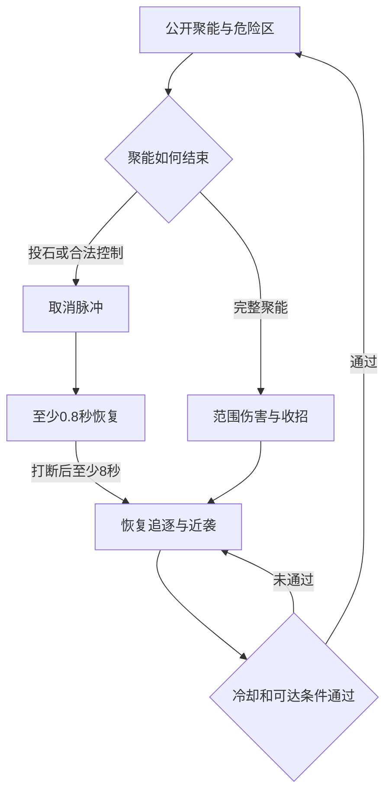

# MA01：投石打断仪式与丝带缠绕

## 仪式是一段可改变的交战

适合可移动的咏唱、奏鸣、哭声本体。固定窗外巨影、线团或机器不因投石获得追逐身体。默认聚能6秒，围绕实际仪式源显示半径4格合法传播区，伤害只在结束时提交。

玩家可离开范围暂避；若要继续在该处处理机制，可以拾起场景碎石投中公开弱点。石头造成0HP伤害，命中正在聚能的弱点可靠打断，不要求抽中装备、购买消耗品或先叠满状态。 弱点必须是姿态中真实外露、能投中的身体前侧或乐器表面，不能被自身装饰碰撞壳挡住；打到其它部位或前方实体只会落石。

打断后恢复原基速追逐，进入合法距离才开始带完整前摇的直接攻击。8秒从真正退出恢复/控制后计算；下一次仪式还须满足原起手起至少16秒。原服务、停食和主规则完成始终优先。

合法冻结/眩晕可取消未提交仪式。定身不取消站桩施法，减速不自动延长聚能，封技仍读原白名单。石头打非仪式目标0伤0控，不能无限石击锁住追逐怪。

## 石头从哪里来

当夜有仪式候选时，班前在两处实际可达托盘预放3枚唯一任务石，分布2＋1，供本夜所有仪式共用。营业不按新怪、新施法或新波次补石。托盘无电、无生命池、无塔挂点；碎石不属于陷阱或抽奖消耗品。

| 动作 | 参数 |
|---|---|
| 携带 | 一个独立任务位，不占普通包或4/6特殊额度 |
| 拾取 | 距离≤0.8格，0.45秒，一只空手 |
| 投掷 | 0.35秒，一只空手，0体力消耗 |
| 飞行 | 10格/秒，最远6格，实际碰撞，不追踪/穿墙 |
| 命中弱点 | 正在聚能的0.35格弱点；同刻优先取消未提交脉冲 |
| 放重物/收占手工具 | 0.25秒，须有真实合法落点并保留原物 |
| 落空 | 同一石在实际碰撞/射程终点附近合法地面落下，可重拾 |

提交前取消，石仍在手；投出后不能取消回包。tray/held/in_flight/landed状态和原ID存档，重放不复制。仪式石不能替代F30原石、钥匙或别的证据。

单个怪物根结束不会吞掉玩家手中或地上石头。夜结按任务物生命周期清退，下夜班前复位；不进永久仓库、不出售、不退款。

## 时间必须真的够用

准入预算：

`反应0.75＋实际放物/收工具＋各真实路段长度÷当时合法步速＋需要的拾取0.45＋投掷0.35＋弹道距离÷10＋余量0.5 ≤ 已宣布聚能时间`

例：收工具0.25、步行4.5格/3.0、拾石0.45、投掷0.35、飞行5格/10，加反应和余量共4.3秒，6秒预告剩1.7秒。此例不代替真实地图路线检查。

重搬、既有减速、缠绕、视线要求和货架都进入计算；不假设体力或跑鞋。起手前可把该次公开预告调长到最多8秒；仍不够、石不可达或投线完全被挡则不开始仪式，继续追逐。不能开始计时后凭空发石救场。 8秒是自然基准上限。当前仪式的合法延长来源只有I37，同次一次加1秒，因此实际聚能最多9秒；I21仍只作用于F50/F60，不能用于仪式。共享3秒总上限不代表仪式已有3秒可用来源。真实伤害时刻与界面同步顺延，延长也须通过剩余阶段与真实06:00预算。

## 丝带命中后仍有操作

带头在明确预告后沿真实窄路径飞出，默认速度8格/秒、最长4格，碰墙终止。多段裹带/发丝是同一攻击，不能多扣几次伤。

有效命中承受该招SAN伤害，最多定身0.6秒，随后35%减速，从命中起总寿命最多2秒。施术者停在原处维持，不能同时追人和补普攻。

玩家按住“挣脱”0.6秒即可结束缠绕，不需道具、空手或体力；这是身体挣动，不会因搬物或包满锁死。也可用真实遮挡连续0.2秒、超过最大长度，或由塔使源死亡、压制、冻结断线。

解除后全来源6秒免再缠，第二根带不刷新旧时长或免缠截止。2秒受击保护期间的新命中不扣伤也不施控，但仍是一次几何碰撞。

S30地面丝仍保持8秒存续、15%慢1.5秒及6秒触发间隔，与主动束缚共用出手节奏；铺丝保留路线压力，带头命中提供短控制。
