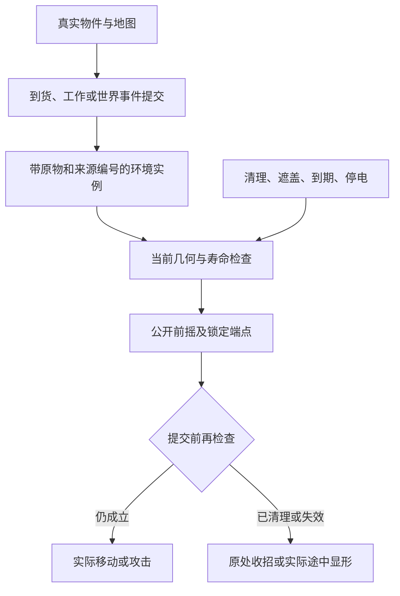

# BC02：环境条件从哪里来、什么时候失效、怪物还能不能行动

基线：`dfd2e32eecb8fb4dc7dd3efa066cfa3817363788`。本文的权威数据是 `content/environment_conditions_bc02.json`；可执行参考为 `scripts/bc02_environment_reference.py`，验证为 `scripts/check_bc02_environment.py`。

## 1. 这次检查得到的真实结论

上一版**已有五条水区的地格、割点、干侧操作位，也已有多个怪的“仅沿真实水路/影节点转场”限制，但没有统一覆盖物源、实际生成、生命周期和提交时重验的运行链**。不能因为旧有限模型夹具里写了 `wet_connected=true`，就认为游戏中已经发生过真实漏水。

另外，当前 **105 个 MD01 个体没有任何一个真正具有镜面穿越能力**。MA01 的 `registered_mirror_node` 是预留地形类型。F60 凸镜用于安全观察；S11 镜旁出现、S38 的原眼镜、S44 双灯投影都不授予镜穿；S23 可以读取实际反射射线，S25 用反光板补光，也都不镜穿。BC02 没有为了填上一个接口凭空新增怪物能力。

本轮建立 23 种条件、逐生产者来源、全 105 个体的条件消费索引以及 13 种已有真转场的原物绑定。设计与有限参考可检验，实际客户端尚未接入，不把这份报告称为 105 个 AI 已经在真实引擎中完成验收。

## 2. 唯一合法的来源链



每份实例保存 `source_event_id`、`source_episode_id`、`source_object_instance_id`、`origin_root_id`、`owner_root_id`、层、当前位置、产生时间、到期时间与版本。原物、事件、世界污染和怪物根各自有身份；物件离场与历史记录保留也分开。

**预约怪不生成条件。** 导演可以预约未来需要的工具和公开任务载荷；载荷仍须由实际实体从入口搬到槽位，付出真实路途与安装时间。部署中取消，原物留在实际中途位置；重新开始必须走回去拿同一件物品。普通杂活只在营业、恢复阶段发生。预兆可继续完成已经预约并公开的实体准备；未准备完就延后正式入侵。玩家在正式根提交前修好漏水、擦断水路，只结真实店务回执，不能刷怪奖励，导演也不能为选中的怪重新制造危险。

原本要求历史交易、此前误收、真正割伤的源，不属于“预兆载荷”。F40 原树苗、F19 原订单、F26/F32 的员工伤口必须已经真实存在。

## 3. 水渍从实际事件进入可消费水图

### 3.1 来源与有限供水

| 来源 | 实际触发 | 供水什么时候结束 | 数量与可见反制 |
|---|---|---|---|
| 前门雨水 | 独立夜初天气种子 20% 为雨夜；世界第 20 秒出现实雨与雨声 | 第 140 秒结束天气事件；关门或铺真实吸水垫可先阻止入店 | 3 秒预警后从门外源格进入，最多 `WET_FRONT` 六格 |
| 冷区接头漏水 | 第三次真实冷柜服务完成后，独立 10% 漏水事件 | 实际隔离接头、关闭冷区支阀或班末 | 接头先滴水 3 秒；只占冷区六格，不能无限扩散 |
| 顾客洒杯 | 完成真实饮料消费，顾客携原杯走到可见地格后，10% 洒出剩液 | 六单位液量逐格灌完即停，最长六秒 | 只沿实际经过的源格和邻接合法地格；到货/消费未完成就没有杯水 |
| 员工椅旁洒杯 | 真实员工休息饮水完成，5% 打翻原杯 | 四单位液量用完即停，最长四秒 | 先有三秒可阻止倾斜，使用椅南四格，不复活已废弃北侧湿格 |
| 后院主渠 | 班前实体巡检实际走到独立主阀并开阀 | 真实关闭主阀或夜终 | 主渠与冷区支路独立；F57 杂物仍须来自真实卸货等事件 |
| 公开任务浅盘/检修水管 | 原载荷从入口真实搬运、安装两秒，再公开水势与割点三秒 | 原源断开、封盖、拆除或本根终结 | 每根一组；使用原水量，闭环管不补造已擦断割点，F28 三盘各有原件与独立阀 |
| F30 原石渗水 | 玩家真的把同一压箱石拿去顶门 | 一单位渗水结束或原石移走 | 没有这次错误动作就没有本地渗水，不能作为导演初始事实 |

**180 秒指停止供水后的残留水寿命，不是所有来源持续供水 180 秒。** 一杯水不会无限续水。自然干燥没有清洁工作回执，不发清洁奖励。

### 3.2 五条原水图保留原几何

| 水区 | 原地格数量 | 主要实际使用者 | 割点与恢复规则 |
|---|---:|---|---|
| `WET_FRONT` | 6 | F34 的强弱拍湿边、F41 的门线压力；个别配置仍须核对应入口 | 擦断 `[13,29]`；当前门的开合参与真实连通图 |
| `WET_COLD` | 6 | F05 原篮、F47 水边；F28 的异常盘使用另行绑定的三支路源 | 擦断 `[24,10]`，玩家在 `[24.5,11.5]` 实际擦拭，原篮干侧交付位不改 |
| `WET_REAR` | 9 | F24 后门货车湿路、F10 局部后窗波带、F57 主渠 | 擦断 `[28,-1]` 可切门内支线；F57 受保护主源不能被冷区阀误关 |
| `WET_AISLE` | 6 | F56 测深与原货取回 | 擦断 `[8,17]`，在 `[7.5,17.5]` 干侧操作 |
| `WET_CHAIR` | 4 | F52 椅下回潜与低灯检查 | 擦断 `[3,8]`，不把椅子上方装饰影当作传送节点 |

水每秒沿真实四邻地格推进一边；实体墙、关闭的门、不同层以及没有被实际灌湿的中间格都能断路。不能把两个蓝色端点间的欧氏直线当水路。停止供水不立刻删除所有残水；**完成擦割点后，割点立即删除，脱源分量在两秒内排干，该事件不自行长回割点**。主源那一侧的水仍可真实存在。

F05 的参考路线从 `[26.5,10.5]` 到 `[23.5,12.5]` 是五条真实边。该移动按实际路长 / 3.3 计时，属于原生水路移动，不发“真转场”事件，也不让虚拟中段触发地面陷阱。途中擦断时，身体停在真实已经走到的位置，公开 1.5 秒显形并保留 2.5 秒收招；不会瞬回水源，更不会改选贴近玩家的出口。

## 4. 镜面、光影与视线分别判断

### 4.1 反光不等于镜穿

固定凸镜对应原地图 `ATT02`，其 `anchor_role=convex_mirror`。`MAP_STORE:ATT02:mirror_surface` 是这件原附件的运行实例别名，位置从地图锚点读取，当前为 `[19.5,22.5]`；不是新发明的免费库存。

普通镜、冷柜玻璃、水膜的反光用于观察或已有攻击明确允许的反射区。相应行为仍检查反射率、实际法线、有限镜面、两段无遮挡光路、当前遮布与破损状态。反射光路几何成立仍需要实际照明或目标自发光：S23 的焰眼有本次真实发光，F60 可使用原手压观察灯；完全无光不能仅靠一面镜观察身份。F60 镜中观察与真实双向对视分开；拉帘只遮住真的与 `OBJ_MIRROR_CURTAIN` 线段相交的视线。怪走到帘的同一侧后，不能继续沿用“已经拉帘所以永久安全”的旧判断。低柜台与高货架按地图的实际视线遮挡属性分开。

候选镜穿接口必须同时具有：

- 两个不同原物 ID，各自完成真实搬运与安装；一面镜不能复制成两端。
- 同一任务根、同一层、明确注册的正面落点与足够空间。
- 两端反射率至少 0.65，未遮盖、未破碎、仍在原位置。
- 明确允许镜穿的物种能力，再通过射程、占用与危险区检查。

当前最后一项对 105 个体全部不成立，因此不会出现任何隐性镜穿。候选接口的有限测试只验证双端拓扑、遮盖、移走和版本过期，没有创建一个测试怪来冒充可玩内容。

### 4.2 影节点也有具名物源

F40 的三处林影由**已经真实误收的原树苗**引发，原路标只关闭各自节点，归还同一株苗后三秒退影。普通关灯、货架边缘的一团黑色贴图都不能替代林影节点。

S22 的暗点先由实际预装遮光筒/局部灯控形成；全部 MAIN 与任务灯的实际入射仍计入总照度。登记节点不等于凭空关掉常照，安装自检不能证明低于 0.2 的点就不准当暗出口。有限参考另有真实 MAIN 灯照进 C、导致暗出口准入失败的反例。

S22 使用三个实际安装的节点和三盏独立任务灯：A `[20.5,18.5]`、B `[22.5,18.5]`、C `[24.5,18.5]`，安全控制端 `[19.5,19.5]`。先锁亮 A/B，保留 C 为暗点；它只能向离玩家更远的合法 C 退散。C 到达后 1.5 秒恢复，最后一秒灯与封牌原子提交。漏过窗口保留 A/B 与原物，等原八秒冷却后重试；已在 C 时用原位真实检测分支，不假发转场事件。

任务灯使用真实预装隔离电池，初始 900 世界秒；这只是初始能量，不能假定超过 720 秒的加时战斗一定结束。必要灯任一剩余不足 10 秒时，可在同一原模块既有安全侧控制端实际手摇 2 秒，使同组原灯获得 60 世界秒。不得提前反复叠加囤能，取消不补能，已有灯开关与封牌状态保留。耗尽本身不自动停战。玩家必须已实际到安全控制半径 1.5 内并开始两秒手摇，且本根当前攻击序列已经结束、旧冻结自然结束，才开启本能量周期一次三秒的本根禁发新攻击窗口。取消不刷新截止，走离安全侧撤保护，窗口用完只能再利用原怪正常的至少两秒落空收招，不会重复白拿保护。永久毒、已付成熟、世界时钟、伤口与原机制绝对截止仍推进，也不免除其它来源伤害；没有结束当前攻击、追补被停的新攻击或重置冷却。手摇提交若已越过原截止，进入原失败/安全撤销终态，不能复活失败任务。S22 的控制端为 `[19.5,19.5]`；其它必要灯沿各自模块真实安全控制位。

手摇器必须随原免费模块实际安装，不能充回被移走的灯，也不发营业 Buff、收入或经验，不充电流过载网络，不反送 MAIN。MAIN 停电会真实停止 MAIN 灯和电器支持；任务手充只是让相同原物保留必要主解短段，不要求被追的人去修总闸。新增大于 900 秒且 MAIN 仍断的实际反例，验证取消无能量、两秒完整动作补六十秒、原 source ID 与 deadline 不变，并能继续原节点路线。

S25 的玩家投影、双反光板与无影圈，S41 暗处扑击，F59 背向暗处施工都在索引中单独标明来源与消费类型。它们各自的原物和主步骤仍由完整遭遇合同负责；“暗”不自动获得“影跃”。

### 4.3 F58 没有热源时用原免费封区，不等待无限备包

重新核对原 F58，暖食路线本来就是可选分支：同一热食品质 40 世界秒、本次雾景 30 世界秒、取走最后暖源的补救窗 3 世界秒，全部沿原时点，不能通过盖盖、放回、备用包或复电重置。BC02 的 20 秒预兆也会消耗已有食品寿命；不够就不能声称暖食分支可用。

**撤回本轮较早草案新增的“900 秒任务保温包，过期换备用包并暂停怪”的必要依赖。** 原设计已经提供完整、免费、无需电源或食物的另一条主解：玩家到 `[24.5,15.5]` 对原冷区暂停牌操作 0.5 秒，沿实际三格路线走到 `[21.5,15.5]`，再完成 0.5 秒退出提交。Lv1 从牌处起合计两秒，走到牌的首段路另外计算。只关闭普通冷区业务，任务冰柜、同事退路和逃生门保持原状态；取消未完成子步骤没有提交，已挂牌进度保留。

MD01 明确这一分支是 `rule_leave` 成功。正式投放的同一根只结一次原基础奖与规则奖，不额外给补热、维护或清洁奖。普通预防挂牌没有被投放怪物的奖励。若玩家始终未处理直到原 120 预算秒外层期限，发原 `expired` 终态且无成功奖，夜班继续，不无限等待补热。

超过 900 秒反例没有伪造一个违反原 120 秒外层期限、仍必须继续的 F58：参考先让两个旧候选原包各自真实到热食设备并受热，再启动 F58，长期断 MAIN。两包从原热源时刻同时自然变冷；F58 早已在原截止终结。取备用包既不能得到新 900 秒，也不能重启已过期根。另一个实际路线反例证明全无热源、MAIN 断电时原牌→三格退路→真实终态可执行。

## 5. 鲜血来源与清洁血污彻底分开

| 状态 | 唯一合法来源 | 时长/容量 | 允许消费 |
|---|---|---|---|
| 员工当前鲜伤 | E003 真实裂玻璃，在至少三秒警示后实际徒手接触/踩原碎片；或已实际激活的 F21 玻璃故障四十秒预告后仍实际接触 | 90 世界秒；每人每夜一次，全夜最多两次；同事故不刷新 | F32 读取真实员工鲜伤；F26 条件型准入 |
| 活血迹 | 上述伤员真实每走两格，在实际身体路径留一迹 | 每迹 30 世界秒；每人最多六，F26 最多绑定三枚 | F26 的真实地面短冲与逐迹擦净 |
| F13 击退血污 | 当前 F13 HP 确实到 0 的原击退回执及真实落点 | 同根最多一处，留待恢复期实际清洁 | 清洁工作；永远不是玩家伤口或鲜血条件 |

普通 HP 伤害、正常顾客、清洁文案、预兆载荷、静态 `GRP_RED_TRACE` 坐标都不是员工流血生产者。包扎需要真正完成三秒，取消不提交；包扎停止新增血迹，但不会抹除此前地面原迹。伤口到期保留事故历史，当前 `fresh` 条件结束。

这里还修正了新导演节奏与旧血源门槛之间的一处冲突：旧合同 12 秒预兆、24 秒反制路途/动作、6 秒恢复、3 秒离场，所以要求剩余 45 秒。BC01/BC02 最短预兆为 20 秒，沿同一保守动作预算需 **53 秒剩余**，并按本次实际退出顾客、准备与行动路途重新计算。F26 还要单独保证到场有同事故仍存活的 30 秒原迹；到场重验失败就安全收尾，不能延长血迹。

F21 事故发生在当前入侵。默认单根的下一次入侵至少隔 `35 恢复 + 60 营业 + 20 预兆 = 115 秒`，已经超过 90 秒伤口寿命。因此 **F21 的伤口不会在默认导演中支持下一场 F26/F32**。根终止不主动擦掉真实伤口，但时间也不能为后续怪暂停或延长。未来若做复合遭遇，必须另行证明两个实体预算、真实人员、救治路径及窗口。

同事故只能预约一个血源消费者；检查两个候选各自是否满足条件只是只读评估，不代表同时投放两只怪。

## 6. 真转场端点按物种绑定

| 物种 | 合法端点来源 | 取消/回退的关键边界 |
|---|---|---|
| F15 | 同根真实铃盒/灯箱投出的公开近端 | 合铃稳定关闭能力；不是任意灯或镜 |
| F19 | 同一原包裹真实以前停过的寄存站 | 当前身体至站超原射程就步行，不补一个中继站 |
| F28 | 同异常盘 A/B/C 原支路 | 普通总阀停水不删除原异常盘；封真实源永久关换源 |
| F30 | 同一实际压箱石当前锚点 | 取走、封存同石后关闭，不复制石头 |
| F36 | 本次实际授权且未撤销的槽域 | 公共顾客权限不等于仓库许可 |
| F38 | 当前连续身份链里的已确认异常显体端点 | 真人不成为敌池，换外观不重置状态 |
| F39 | 原灶位木牌与真实迁位目标 | 迁原牌与关旧位逐点关闭 |
| F40 | 原树苗产生的三处固定林影 | 路标切真边；归苗后普通步行 |
| F59 | 同故障、原三份材料和真实施工槽 | 不凭工具动画生新实体/新原料 |
| S02 | 本体实际接触真实墙面产生的腐痕与合法背面空地 | 不用镜/影替代穿墙；封板撤相应边 |
| S22 | 当前同根三个真实任务暗点 | 只防御远离；点亮 C 取消未提交退散 |
| S23 | 实际四向十字路口、引导栏及返程通道 | 只能偏离后回原路口，不选择近玩家落点 |
| S40 | 明示六格真转场能力，在合法地面实际画出的双端预告 | 不依赖水/镜；只有本物种可用这类无介质端点 |

共同次序是：当前源/层/几何成立 → 起终点预告 → 前摇完成重验 → 到达前重验 → 真实提交。条件清除、原物被移走、端点被占、根终结都能取消。取消保留冷却、HP、毒、已经付费的成熟期限和已完成规则步骤，不换落点、不复制物件。真转场的虚拟中线只走原 TD05 相位审计；没有实体经过就不能顺便触发地面陷阱或电器接触。

## 7. 普通杂活与战术动作如何分开结算

水、血、垃圾等普通工作只在营业/恢复期进入工作队列；进入预兆/入侵时不再不断生成补货、收银、卸货、清洁催办。RAID 中仍可进行当前根已公开、具有真实安全窗口的战术反制，例如 F05 擦割点、F26 包扎擦迹、S22 关最后节点。这些是正在进行的遭遇玩法。

清洁以原 `source_episode_id:cleanup_once` 结一次工作收益。玩家必须真实走到原污迹并完成清洁动作，源已经隔离、实际污染已处理完才可领；自然蒸发、同源反复开关、对已干地面点擦布、把同一污染换 root ID，都不能生成工作收益。F13 尸血与普通水污走清洁账本，鲜血的伤口/血迹走事故账本；二者不能互相转换。

这些环境时长与便利店设备的战斗储备不同。180 秒残水、90 秒伤口、30 秒血迹、6 秒呼吸雾点各有真实寿命，不因为营业增益改成跨遭遇储备就一并延长。

## 8. 可执行范围与 Codex 接入边界

运行：

```bash
python scripts/check_bc02_environment.py
```

本次验证覆盖 41 个不同场景，结果保存 `docs/bc02_environment_report.json`。包括真实搬运后才生成水、取消和闭门、逐格推进、有限杯水与雨结束、实际擦割点、途中断路、断电、镜双端遮盖/移走/低反射率、S22 真暗点与回退、鲜血实际移动、90/30 秒超时、20 秒预兆预算、双消费者互斥、F13 血污隔离、自然蒸发零清洁收益、真实声音传播、帘子同侧绕过与世界暂停。

报告的断言数包含大量源文件/JSON Pointer 完整性检查，不能把每个索引检查当作一场游戏。报告哈希包括实际读取的地图、BC01 几何实现、MD01/MA01/TD05/V06 源合同及本轮文件；底图或规则变化后必须重新运行。

有限参考已经连续计真实世界时间、逐边水图和人体路径，不等于客户端逐帧敌人 AI。S22 的物理节点是参考中实际模拟的影转场例；其他 12 种端点的原物/历史生产器必须连接其真实工单与对象适配器，不能把通用 `phase_anchor` 放置接口当作伪造原物的后门。声音参考使用保守地面通道长度；生产引擎仍须按各 MA01 攻击实际高度和已登记隔声面生成对应传播图。镜反射参考是有限平面几何，凸镜画面渲染仍须验证原有限观察区与遮挡。

建议按依赖落地：先做 `SourceEventLedger` 和实例/根/原物持久化，接五区 `WaterGraph` 与 F05；然后接真实事故 `Wound/Trail` 和反应型准入；再接独立任务灯、S22/F40 源和动态视线；最后接 F60/S23 的反射几何。原最小可玩批 F12/F13/F05/F17 可以首先验收原物、低空高度、水切断、非敌对领取；候选镜穿接口保留，当前没有必须新增的镜穿怪。

## 9. 全量消费索引

所有 105 个体均登记 `SURFACE_ROUTE` 与 `VISIBLE_LINE` 的实际能力/玩家工作位检查；这只是通用空间前提，不给锚定怪增加移动。下表列出具有额外环境条件的实际个体。每项完整 `source_ref`、`consumer_type` 与条件生产者可在 JSON 的 `monster_consumers[].uses` 逐条追溯。

| 个体 | 额外条件 | 消费类型 |
|---|---|---|
| F03 僵尸 | 玩家真实呼吸雾点 | movement |
| F05 河童 | 同层真实连通水图；活水与可达干格的共同边 | movement_or_rule、attack_or_rule |
| F07 座敷童子 | 真实声源及传播路径 | attack_cue_or_rule |
| F09 轆轤首 | 实际门与边界许可 | movement_permission_or_rule |
| F10 海坊主 | 活水与可达干格的共同边；真实窗缝与预告锁窗；真实声源及传播路径 | attack_or_rule、attack_cue_or_rule |
| F13 飞头女鬼 | 实体击退后的清洁污迹 | producer_only |
| F15 蓬蒂雅娜 | 物件/地标支持的真转场端点；真实有效照明 | movement、rule |
| F19 吠陀罗尸鬼 | 物件/地标支持的真转场端点 | movement |
| F21 报丧女妖 | 真实声源及传播路径 | attack_cue_or_rule |
| F24 凯尔皮水马 | 同层真实连通水图；活水与可达干格的共同边；实际门与边界许可 | movement_or_rule、attack_or_rule、movement_permission_or_rule |
| F26 红帽妖 | 真实员工当前伤口；伤员真实移动留下的活血迹 | reactive_admission、movement_or_rule |
| F28 诺肯水乐灵 | 物件/地标支持的真转场端点；真实声源及传播路径；真实声源及传播路径 | movement、identity_test、attack_cue_or_rule |
| F30 海亡灵 | 同层真实连通水图；物件/地标支持的真转场端点；实际门与边界许可 | conditional_misuse_only、movement、movement_permission_or_rule |
| F32 夜返吸血鬼 | 真实员工当前伤口；实际门与边界许可；真实声源及传播路径 | reactive_admission、movement_permission_or_rule、attack_cue_or_rule |
| F34 鲁萨尔卡水灵 | 同层真实连通水图；活水与可达干格的共同边；实际门与边界许可；真实声源及传播路径 | movement_or_rule、attack_or_rule、movement_permission_or_rule、attack_cue_or_rule |
| F36 精灵访客 | 物件/地标支持的真转场端点 | movement |
| F37 古尔荒野妖 | 实际门与边界许可 | movement_permission_or_rule |
| F38 双重身 | 物件/地标支持的真转场端点 | movement |
| F39 多莫沃伊家宅灵 | 物件/地标支持的真转场端点；真实有效照明 | movement、rule |
| F40 列希森林灵 | 有来源的登记影节点 | movement |
| F41 哭泣女 | 活水与可达干格的共同边；实际门与边界许可；真实声源及传播路径 | attack_or_rule、movement_permission_or_rule、attack_cue_or_rule |
| F42 哨声亡灵 | 实际门与边界许可；真实声源及传播路径 | movement_permission_or_rule、attack_cue_or_rule |
| F43 图恩达 | 实际门与边界许可 | movement_permission_or_rule |
| F47 水歌伊阿拉 | 同层真实连通水图；活水与可达干格的共同边；真实声源及传播路径 | movement_or_rule、attack_or_rule、attack_cue_or_rule |
| F48 河海豚化人客 | 实际门与边界许可 | movement_permission_or_rule |
| F50 泽西恶魔 | 真实窗缝与预告锁窗 | attack_or_rule |
| F52 矮水灵托科洛舍 | 同层真实连通水图；活水与可达干格的共同边；真实有效照明 | movement_or_rule、attack_or_rule、rule |
| F56 深水邦耶普 | 同层真实连通水图；活水与可达干格的共同边 | movement_or_rule、attack_or_rule |
| F57 水路守护塔尼瓦 | 活水与可达干格的共同边；后院主渠真实复流 | attack_or_rule、rule |
| F58 雾笛访客 | 真实保温区域；真实声源及传播路径 | optional_rule_branch、attack_cue_or_rule |
| F59 梅内胡内工队 | 物件/地标支持的真转场端点；真实低照度区域；真实有效照明；真实双向直视/单向观察 | movement、rule_or_attack、rule、observation_or_attack |
| F60 马面引路者 | 实际反射表面；真实双向直视/单向观察；真实有效照明 | observation_or_attack、observation |
| S01 凝视塑像 | 真实有效照明；真实双向直视/单向观察 | rule、observation_or_attack |
| S02 腐蚀穿墙者 | 物件/地标支持的真转场端点 | movement |
| S03 遮面追逐者 | 真实双向直视/单向观察 | observation_or_attack |
| S05 拟声猎群 | 真实声源及传播路径 | attack_cue_or_rule |
| S10 余光攀行者 | 真实双向直视/单向观察 | observation_or_attack |
| S11 铃声后的瘦影 | 真实声源及传播路径；真实双向直视/单向观察 | attack_cue_or_rule、observation_or_attack |
| S13 楼梯口无面影 | 实际门与边界许可 | movement_permission_or_rule |
| S18 双灯猎行者 | 真实有效照明 | rule |
| S22 畏光烟影 | 有来源的登记影节点；真实低照度区域；真实有效照明 | movement、rule_or_attack、rule |
| S23 路口焰眼犬 | 实际门与边界许可；实际反射表面；实际十字路口及返程通道 | movement_permission_or_rule、observation_or_attack、movement_or_rule |
| S25 吞影小像 | 真实有效照明；玩家身体真正投下的影子；双反光板补齐的无影圈；实际反射表面 | rule、attack、observation_or_attack |
| S29 暗育蜈群 | 真实有效照明 | rule |
| S34 寻声线团 | 真实声源及传播路径 | attack_cue_or_rule |
| S36 惊笑偶像 | 真实声源及传播路径；真实双向直视/单向观察 | attack_cue_or_rule、observation_or_attack |
| S40 取述影客 | 物件/地标支持的真转场端点 | movement |
| S41 地窖食客群 | 真实低照度区域；真实有效照明 | rule_or_attack、rule |
| S42 断拍窥猎者 | 真实声源及传播路径 | attack_cue_or_rule |
| S43 闭店巡场员 | 实际门与边界许可 | movement_permission_or_rule |
| S44 双灯影幕 | 真实有效照明 | rule |
