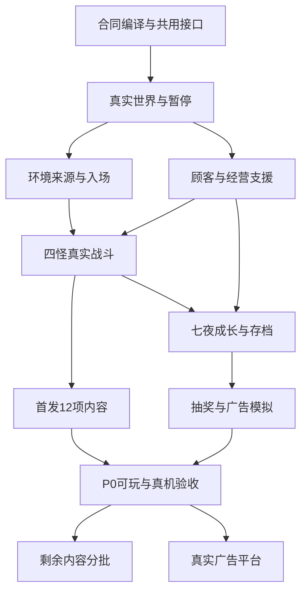

# BC02：Codex落地计划与可玩验收

这份计划以本轮持续时间、环境来源、105条遭遇前置和广告合同为输入。先把已找到的矛盾修成明确规则，再把规则交给真实世界消费者。当前仓库仍有V0.10两怪网页和多个有限参考模型；本文件安排的是独立BC02客户端的制作，不把设计报告当成游戏已经完成。

机器任务表为[implementation_plan_bc02.json](../content/implementation_plan_bc02.json)，执行提示为[100_bc02_codex_start.md](100_bc02_codex_start.md)。全部新增实现都从[BC02权威表](../content/system_authority_bc02.json)解析，不由Codex自行选择一份旧文档中的同名字段。

## 1. 先冻结哪些规则

| 领域 | 已确定的实施输入 | 接线时必须保留的约束 |
|---|---|---|
| 经营支援 | [整场设施](95_bc02_facility_duration.md)与[真实顾客路线](101_bc02_customer_routes.md) | 待战无倒计时，持续效果覆盖本场；每来源2份/本场最多用1份，回血实际预算ack，停电同源暂停，不用旧`expires_at`消费者 |
| 地面与空间条件 | [环境来源](96_bc02_environment_sources.md) | 每个水/影/血/反光/锚都有真实来源、版本、寿命和清除；瞬移前后复验，普通反光不是传送门 |
| 怪物前提 | [105条前置](97_bc02_encounter_prerequisites.md) | 原物供应、真实历史、任务NPC、步骤窗口、误操作恢复、终态和清理逐条消费，不补写过去发生的事 |
| 玩家与阶段 | [玩家共用前提](../content/player_loop_bc02.json) | 真实手/路/时窗，RAID普通店务不推进，主解免费；任务NPC与普通顾客区分；等级只改允许加速的手工部分 |
| 广告 | [广告合同](99_bc02_advertising.md) | 三处入口、唯一暂停服务、正常收益先入账、固定原G再加G、独立额外券、nonce和原子领奖 |
| 未改部分 | BC01、MD01、MA01、TD05、EQ01及SA02明确保留的合同 | 单主根、永久毒、真实原物、根奖励去重、HP/SAN分域、夜7周清都不被实现便利性改掉 |

D00是设计输入门：执行`python3 scripts/run_validation_bc02.py`并确认报告输入哈希匹配。这个门允许开始实现。客户端的可玩、真实碰撞、触屏、性能和平台广告另有验收，不用设计检查总数代签。

## 2. 技术路线和目录

采用**TypeScript纯游戏核＋Canvas2D表现层＋平台适配接口**。先沿现有俯视地图做可读灰盒，完成机制后再补角色动画和音效。Web用于日常开发、自动检查和可玩交付，微信小游戏通过平台层适配输入、生命周期、存储、音频与广告。首个任务检查实际工具链并锁定版本和lockfile；这里不凭空写“最新版本”。

新增目录安排如下，这些是**将创建的目标路径**：

| 目标目录 | 唯一职责 |
|---|---|
| `client/src/content/` | 编译权威覆盖、schema、能力白名单和实际内容准入；保留源文件/字段指针 |
| `client/src/core/` | 世界时钟、暂停持有者、稳定随机流、命令队列与事件顺序 |
| `client/src/world/` | 导航、身体/地层、物件与占手、环境来源、光/声/反射、动作提交 |
| `client/src/combat/` | MA01攻击前摇/命中/收招、HP、状态、塔、陷阱、同根子体 |
| `client/src/game/` | 顾客、店务、导演、设施、遭遇主解、战役、成长、准备和抽奖 |
| `client/src/persistence/` | 全量快照、稳定夜键、命令去重、版本竞争和一次提交 |
| `client/src/ui/` | HUD、已知线索、上下文交互、暂停、结算与抽奖；界面不拥有金币或怪物状态 |
| `client/src/ads/` | Disabled/Fake/WeChat三个provider、广告邀请与完成事件；不直接改钱/券 |
| `client/src/platform/` | Web与微信接口，环境能力和外部配置 |
| `client/tests/`、`docs/runtime/` | 可重现行为用例、实际录像/事件轨迹、每批验收与内容开关证据 |

JSON中的中文说明是设计说明，不能用`eval`执行。Codex需要把结构化动作和条件绑定到具名处理器；未知处理器在编译/准入时给出原因。保留旧两怪练习用于历史回归，新客户端用显式`bc02`模式与独立存档版本，不能把不同版本的世界事实混在同一局里。

## 3. 共用接口先落地

**SourceReceipt**包含事件ID、逻辑夜、attempt、根ID、原物ID、所有者、世界时间、来源版本和事件种类。历史来源由已完成且固化的真实交易/工单生产，不能由怪物进入场景时临时填写。

**ActionRunner**检查实际角色、物件绑定、操作面、距离/朝向/遮挡、手数、当前许可和动作类型；完成后提交世界变化，取消保留已提交子步骤。手动进度按当前等级/活跃设备分段积分，NPC领取、观察、节拍等真实等待保持原时长。

**ConditionLease**绑定当前来源和版本，保留同根、地层和绝对过期时刻。预订遭遇、真正入场、位移前摇完成三处按需要复验。水被擦断、镜被遮住、原物搬走时撤销能力，不能重选近旁另一个落点掩盖失效。

**RuleOutcome**必须来自实际主解和响应片段。动作计划播完不是击败；同根实际HP归零或完成实体离场才提交终态。正式客户端不得调用Python的条件命中排程来替代真实怪物攻击和玩家操作。

**CampaignRepository**保存所有实际状态owner同一版本，包括未完成行动、源物件、环境、伤口/痕迹、电源epoch、永久毒/成熟队列、支援预算、顾客领取权和广告回执。任务能源cycle、原恢复窗截止、原rule deadline和顾客多次撤离的访问ordinal也要保存，读档不能重开保护窗或复用visit ID。不能在有活跃消费者时用空数组占位。HP恢复请求与实际HP应用/预算ack必须同一世界边界提交。

世界模拟建议固定60步/秒，渲染可独立；量化误差、超时与同帧事件顺序写进测试。低帧时不能悄悄补跑看不见的攻击。暂停/后台/广告完全停止世界，外部广告超时另用单调墙钟；恢复不补算暂停期间时间。

## 4. P0按可玩结果拆成任务

每项详细目标文件、依赖和验收在机器任务表。以下顺序是实际施工顺序。

| ID | 做什么 | 可交付验收 |
|---|---|---|
| C00 | 独立客户端、数据编译与构建 | 能打开BC02灰盒门店；新旧字段覆盖可追溯；构建/检查命令可重复 |
| C01 | 世界移动、原物/占手/动作、暂停 | 取箱→走路→暂放→拾回保留同一物件；开暂停300秒后状态不变 |
| C02 | 环境来源与入场事务 | 真实水源逐格传播；F05没有湿路不进场；擦断和源过期取消真实许可 |
| C03 | 顾客、杂活、随机阶段、设施 | 全部公共服务真实走到/使用/付款；未完成不发支援；长战斗/停电/回血预算可复现 |
| C04 | F12/F13/F05/F17四怪纵向切片 | 可亲手玩完真实一夜；有真实攻击、HP失败、主解与T02伤害，不自动算赢 |
| C05 | 补齐其余首发内容 | F01/F60/S09/S29/S34/S40/S43加S38；共11主动与1无奖被动，各自有实际正常/错误/恢复场景 |
| C06 | 等级、准备、七夜、完整存档 | 失败整笔回滚，成功固化XP，下一班成长；真正关浏览器再开能续局；第7夜周清一次 |
| C07 | 最小完整抽奖与装备道具 | 六项实际消费者覆盖三品质×两类别，保底/重复补偿/领取箱和扣券时间原子一致 |
| C08 | 广告槽和模拟provider | 三处入口及正常继续；完整/提前关/无填充/旧回调/崩溃/周界可复现且只领奖一次 |
| C09 | P0可玩包与微信适配验收 | 完整七夜、首发内容、触屏和真实存储全部串通，有设备日志和游玩证据 |
| C10 | 真实广告平台 | 接真实配置与回调、账户奖账和真机异常路径；无填充仍能正常游玩 |

### P0内容范围明确

第一份可玩交付M1包含F12回形针、F13肉箱、F05水路和F17包裹，覆盖追逐、低空/地面、环境割点、同原物领取与永久毒下响应。它同时有真实经营、整场支援和720秒夜班，避免只做一个孤立小游戏。

M2完成现有12项首发几何范围。首发塔先做**T02完整7节点族**，陷阱先做**R01/R02/R07基础装置**及其同型临时赠送消费者；实际购买与临时放置共享容量，后续C11再扩全部树。其它内容不出现在可购买界面中冒充已实现。

P0抽奖池明确为`BC02_P0_EQ01_6`：普通Q09/I25、非常见Q14/I32、稀有Q15/I41。它沿用原品质60/30/10、类目50/50和保底，只有六个消费者都实际完成后才开放。前端列出这六项真实奖品，不能展示52项却只发少数几项。扩池保留旧未完成draw的池版本和候选；C11完成原34启用装备和18特殊道具。稀有道具的实际作用、原价格、原持续与代价按EQ01读取，不能为了让广告好看另造奖励。

P0必须包含全部14类设施职责和12个可奖励来源。FR07监控和FR08照明以其真实控制/信息职能接入，不伪装成顾客使用奖励。正常顾客的服务偏好转为真实路线；无需每一晚保证所有来源都使用一次。

### 可以并行的部分

接口稳定后，顾客支援、环境/怪物、界面/广告可分支并行；同一个状态owner由一名负责人维护。每项用小PR交付，写清可玩改变、复现命令、视频/轨迹和仍未启用内容，避免多个代理同时修改金币、时钟或原物真源。

## 5. 其余93项逐批实现

下面九批恰好覆盖首发12项以外的93项；完整名单在机器表和逐怪前提中。每条都使用自己的原物、来源与模块要求，不能只复制模板后改ID。

| 批次 | 数量 | 施工内容与关键门 |
|---|---:|---|
| `P1_order_and_offer` | 11 | F04/F06/F09/F11/F20/F27/F29/F44/F47/F48/F55；真实订单、报价、食品/商品供应与NPC接收，异常交易不冒充普通顾客 |
| `P1_history_identity` | 12 | F02/F16/F18/F19/F23/F25/F37/F38/F41/F43/F45/F51；班前真实基线、当前身体证据、原销售与交付、跨班原物、工作历史 |
| `P1_environment_routes` | 11 | F10/F24/F28/F34/F40/F52/F56/F57/S22/S23/S25；水源、干侧、影节点、反射、通道与可见反制 |
| `P1_work_orders` | 12 | F07/F08/F21/F22/F31/F35/F36/F39/F49/F53/F58/F59；真实工单、任务同事、保护区域、休息/租位、自动夜结账与主解分离 |
| `P1_timed_originals` | 10 | F03/F15/F26/F30/F32/F33/F42/F46/F50/F54；双手搬运、不可刷新的时窗、活伤活迹、同一原物和错失后的有界恢复 |
| `P1_containment` | 10 | S01/S02/S03/S06/S07/S13/S31/S32/S35/S39；真实笼/槽/车道/门/脚圈，按身体宽度验证收容和返舱 |
| `P1_side_workstations` | 17 | S04/S05/S10/S11/S12/S19/S20/S21/S24/S26/S30/S33/S36/S37/S42/S44/S45；证据侧台、实际咬痕、残丝、武器等原物收回 |
| `P1_finite_lineages` | 9 | S08/S14/S15/S16/S17/S18/S27/S28/S41；同根子体、有限原料/卵/源口、已死编号和实际存活编号分别闭合 |
| `P2_host_opt_in` | 1 | F14；真实人类宿主和保护模式独立验证，沿原默认关闭策略，不攻击正常人类 |

扩展顺序按依赖：订单事实先于跨班历史；环境先于血源/湿路限时主解；大模块和子体身份先于谱系闭合。每卡有六类实际用例：正常解、缺前提拒绝、操作中断、源/原物失效、终态唯一奖励、存档恢复。涉及源TTL、宽体、长路径和NPC响应的再做相应边界。单项通过后只开放该项，组合另验。

## 6. 系统目录和组合最后补齐

C11扩完TD05的10塔族70节点、16陷阱族80节点，以及EQ01的34装备和18特殊道具；逐族实现真实消费者，不能把弹匣、DoT、普通装填、移动段、法术与永久毒都塞进同一“攻速”字段。旧事件、宠物、部署按SA02/SA01保留的七夜与所有权合同接入；尚未迁移的事件先补具体来源和期限，不能恢复旧每小时一怪排程。

永久毒和原生电反馈仍按原合同。性能优化可汇总等价状态、复用对象和裁剪离屏表现；不得为省运算偷偷给q、电反馈或根状态增加新上限、衰减或清空。动态导航不得把“计划能到”当成“怪物已经到达”。

C12在单项正确的前提下验原有合法组合，保留标准单主根模式；105索引不是自动放开全部两两配对的许可。最终发布表逐条列出已实装、条件受限、可选默认关闭和实际验收证据。

## 7. 手感、视听和性能也有验收对象

默认横屏，使用安全区自适应；逻辑视窗16×9格，摄像机跟随有边界。左侧移动，右侧朝向拖动/锁定朝向和主要交互，让玩家可以边退边观察。上下文重叠时能切换目标，显示原物图标与缺失条件，取消有明确反馈。无需稀有装备才能完成凝视、取放或逃离。

HUD只展示玩家已观察或已验证的身份状态，不用后台怪物类型提前泄漏冒名者。低画质仍保留湿路边界、割点、反射/阴影状态、危险预告和断电失效。设置里关闭音量不会改变世界SoundField；真正关掉店内广播才撤掉声源，声音谜题同时有来自实际声源的方向/字幕提示。

在低档Android、中档Android和iOS三类实际设备上记录帧耗时、内存峰值、手指遮挡和误触；项目目标30fps保底、60fps优先，这是验收目标，尚不是平台性能保证。录制至少一场180秒以上的真实战斗、一次断电恢复、一次后台/广告恢复与一次关键物件中断，核对表现与事件日志一致。

先验证灰盒可读和核心循环有趣，再做最终美术。需要的资产清单包括：玩家/正常顾客/任务NPC、11主动首发与S38、任务原物、设施工作/断电态、可辨认的预兆/前摇/命中/收招、环境源与割点、支援/预算/广告UI。扩到SCP内容时继续保留现有来源、署名和许可文件，按项目实际素材另建清单。

## 8. 广告正式上线在最后一层

C08已经要求留出所有位置和模拟异常链，不能等游戏发版时才硬插一个视频按钮。C10再接真实广告商配置、平台能力、账户奖账与真机回调。没有可用广告仍正常暂停、结算、继续和使用已有券；真实广告开关须在真实配置与验收完成后开启。

展示请求及nonce必须先持久化再调用provider。旧结果页关闭和迟到onLoad不能改变已开始的下一夜；完整关闭回调即使被拒奖，也必须释放当前广告自身暂停。这些是C08的实际状态反例，不留给上线后补救。

广告经济按四组独立比较：零广告、只翻金币、只领券、两者全看。比较塔升级时点、当周消费、装备获得与失败恢复，继续保留无广告免费通路。第7夜没有可消费旧周金币，故该夜只给额外券入口。平台服务端完成验证仅采用实际可用能力，不把本地布尔回调当成已经验证的服务器签名。

## 9. 交付和接续方式

每个任务提交实际代码、可玩入口、必要行为用例和边界说明。内容准入开关随真实验收单独修改，修改必须能追踪到对应消费者和证据。发现新矛盾时，先写能复现的反例和限定规则修订，再改实现，不能靠关闭全部内容来宣称设计完成。

按M1四怪完整一夜、M2首发七夜P0、M3系统/目录/真实广告三个可玩里程碑推进。工期在每批完成后依据实际速度估算；目前没有把尚未做的AI、手机性能、美术和平台接入写成确定的几天工期。

本轮把上述执行输入放入GitHub并提供可直接交给Codex的起始任务。当前会话没有独立Codex云任务启动接口，因此没有宣称另一个任务已经排队或完整客户端已经开始运行；可用当前仓库分支直接开始C00。
